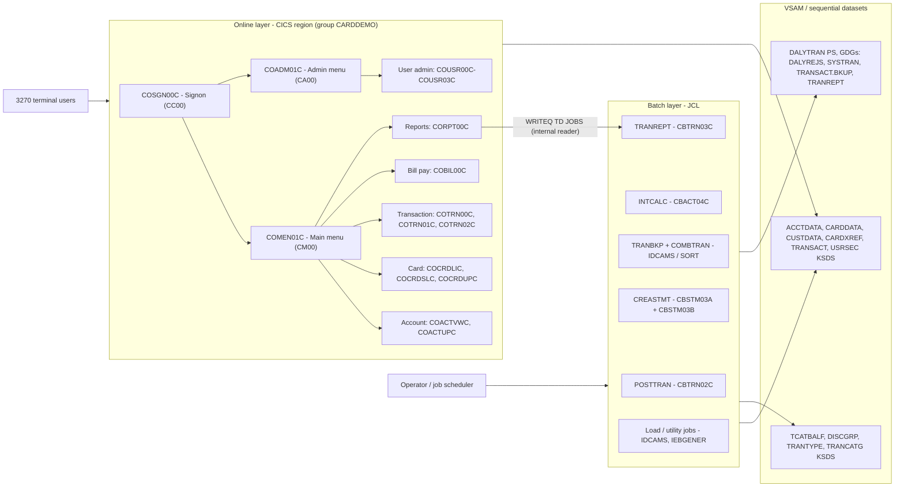
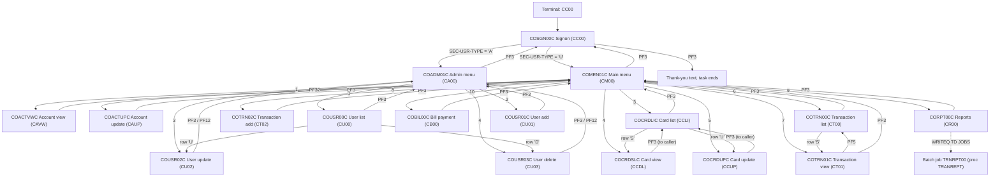
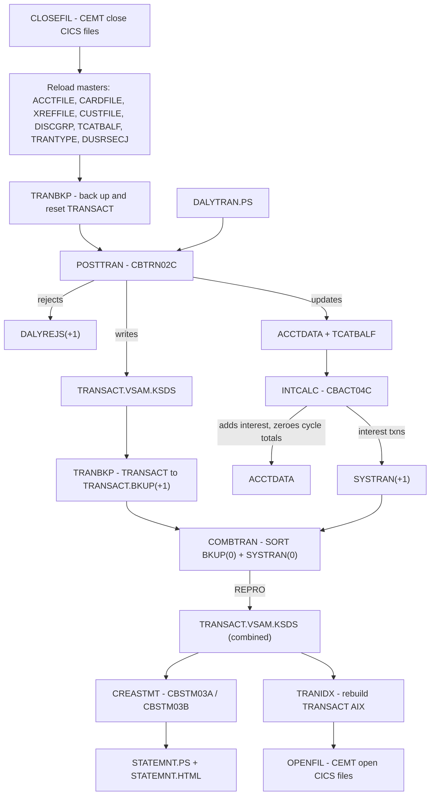
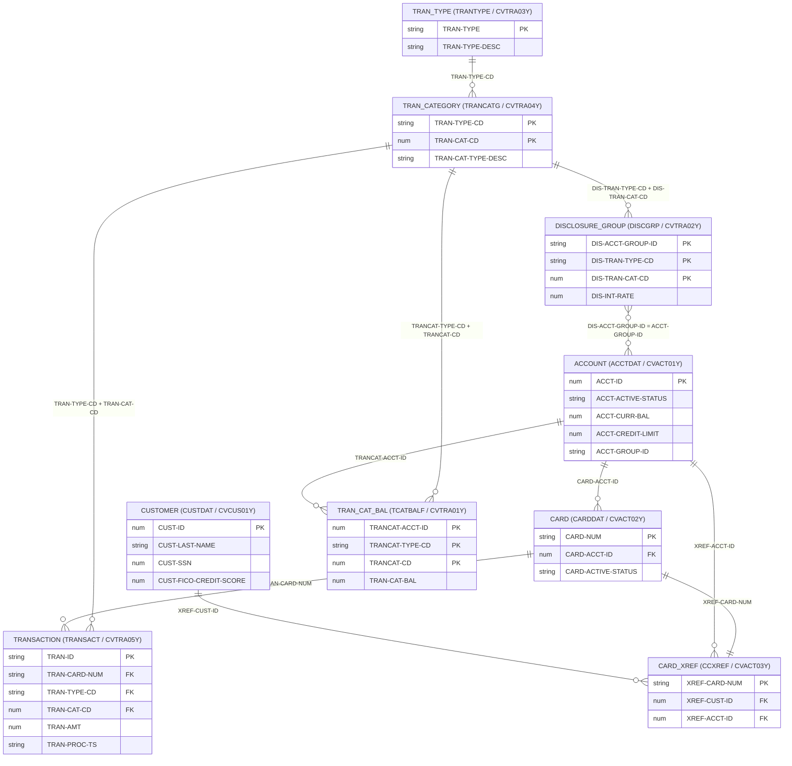
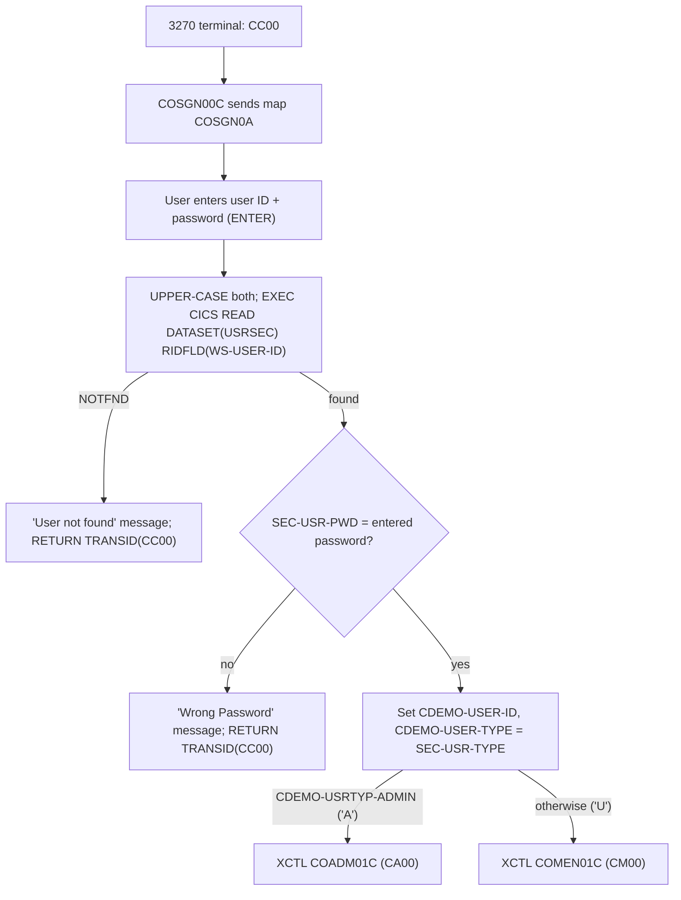

# CardDemo Architecture

This document describes the architecture of CardDemo, the COBOL/CICS/VSAM/JCL credit card management application in this repository. Every program, transaction ID, file, dataset, job and copybook field named here comes from the source under `app/`. Where the source disagrees with [`README.md`](../README.md) or the data model diagram, the difference is called out.

## Contents

1. [Executive summary and purpose](#1-executive-summary-and-purpose)
2. [System overview and technology stack](#2-system-overview-and-technology-stack)
3. [High-level component architecture](#3-high-level-component-architecture)
4. [Repository layout](#4-repository-layout)
5. [Online application flows](#5-online-application-flows)
6. [Batch processing architecture](#6-batch-processing-architecture)
7. [Data layer](#7-data-layer)
8. [Security and administration](#8-security-and-administration)
9. [Build and runtime environment](#9-build-and-runtime-environment)
10. [Modernization considerations](#10-modernization-considerations)
11. [Glossary](#11-glossary)

---

## 1. Executive summary and purpose

CardDemo is a sample mainframe credit card management application. It exists to give modernization tooling and teams a realistic target for:

- **Discovery**: inventorying programs, screens, files and jobs, and recovering business rules.
- **Migration**: rehosting to emulated runtimes such as Micro Focus or UniKix (packaged runtimes are in `samples/m2/`).
- **Refactoring**: converting COBOL/CICS to languages such as Java or TypeScript.
- **Service extraction**: carving out account, card, transaction, billing and user-security capabilities as services.
- Related uses listed in the README: performance testing, augmentation, service enablement, test creation and test harnesses.

The [README](../README.md) notes that the coding style is deliberately uneven so that analysis and transformation tools meet a variety of COBOL idioms. For example, `COACTUPC` uses a structured layered style, `CBSTM03A` uses `ALTER` and `GO TO`, and the `COUSR*` programs use a simple paragraph style.

The application has two user types: **regular users**, who manage accounts, cards, transactions, bill payment and reports, and **admin users**, who manage application users in the `USRSEC` file.

Size: 28 COBOL programs (17 CICS online programs, 10 batch programs and 1 date-validation subroutine), 17 BMS mapsets and 29 JCL members, about 19.3k lines of COBOL in total.

---

## 2. System overview and technology stack

| Layer | Technology | Where in this repo |
| :--- | :--- | :--- |
| Language | Enterprise COBOL (batch and CICS) | `app/cbl/*.cbl`, `*.CBL` |
| Online TP monitor | CICS, pseudo-conversational (`EXEC CICS RETURN TRANSID(...) COMMAREA(...)`) | `app/cbl/CO*.cbl`, `app/csd/CARDDEMO.CSD` |
| Screens | BMS mapsets (3270), symbolic maps generated as copybooks | `app/bms/*.bms`, `app/cpy-bms/*.CPY` |
| Persistence | VSAM KSDS clusters with alternate indexes and paths; sequential PS files and GDGs for batch | `app/jcl/*FILE.jcl`, `app/catlg/LISTCAT.txt` |
| Batch | JCL jobs and catalogued procs; IBM utilities IDCAMS, IEBGENER, IEFBR14, SORT, SDSF | `app/jcl/`, `app/proc/`, `app/ctl/` |
| Security | Application-level sign-on against the `USRSEC` VSAM file (user ID, password, user type). The README lists RACF; the code itself does not call RACF. | `COSGN00C`, `CSUSR01Y`, `DUSRSECJ` |
| Language Environment | `CEEDAYS` (date validation in `CSUTLDTC`) and `CEE3ABD` (batch abends) | `app/cbl/CSUTLDTC.cbl`, `CB*.cbl` |
| Online-to-batch bridge | Extrapartition TDQ `JOBS` (DDNAME `INREADER`) used to submit JCL from CICS | `CORPT00C`, `CARDDEMO.CSD` |

### Pseudo-conversational pattern

Every online program follows the same skeleton:

1. If `EIBCALEN = 0` (no COMMAREA), the program was started without context and routes back to sign-on (`COSGN00C`). `COSGN00C` is the exception: it sends the sign-on screen.
2. Otherwise it copies `DFHCOMMAREA` into `CARDDEMO-COMMAREA` (copybook `COCOM01Y`). On first entry (`CDEMO-PGM-ENTER`) it sends its map. On re-entry (`CDEMO-PGM-REENTER`) it receives the map and branches on `EIBAID` (ENTER/PF3/PF4/PF5/PF7/PF8/PF12).
3. Navigation to another program is always `EXEC CICS XCTL PROGRAM(...) COMMAREA(CARDDEMO-COMMAREA)`. The caller sets `CDEMO-FROM-PROGRAM`/`CDEMO-FROM-TRANID` and resets `CDEMO-PGM-CONTEXT` to 0.
4. The task ends with `EXEC CICS RETURN TRANSID(<own tranid>) COMMAREA(CARDDEMO-COMMAREA)`, so the next keystroke restarts the same program.

`CARDDEMO-COMMAREA` (`app/cpy/COCOM01Y.cpy`) is the only state carried between tasks:

| Group | Fields |
| :--- | :--- |
| `CDEMO-GENERAL-INFO` | `CDEMO-FROM-TRANID`, `CDEMO-FROM-PROGRAM`, `CDEMO-TO-TRANID`, `CDEMO-TO-PROGRAM`, `CDEMO-USER-ID`, `CDEMO-USER-TYPE` (88 `CDEMO-USRTYP-ADMIN` = `'A'`, `CDEMO-USRTYP-USER` = `'U'`), `CDEMO-PGM-CONTEXT` (88 `CDEMO-PGM-ENTER` = 0, `CDEMO-PGM-REENTER` = 1) |
| `CDEMO-CUSTOMER-INFO` | `CDEMO-CUST-ID`, `CDEMO-CUST-FNAME`, `CDEMO-CUST-MNAME`, `CDEMO-CUST-LNAME` |
| `CDEMO-ACCOUNT-INFO` | `CDEMO-ACCT-ID`, `CDEMO-ACCT-STATUS` |
| `CDEMO-CARD-INFO` | `CDEMO-CARD-NUM` |
| `CDEMO-MORE-INFO` | `CDEMO-LAST-MAP`, `CDEMO-LAST-MAPSET` |

Several programs append their own private area after this common block, for example `CDEMO-CU00-INFO` in `COUSR00C` and `WS-THIS-PROGCOMMAREA` in `COCRDLIC`.

---

## 3. High-level component architecture

CardDemo has two processing layers that share one set of VSAM datasets:

- **Online layer (CICS)**: sign-on `COSGN00C`, main menu `COMEN01C`, admin menu `COADM01C`, and the function screens for accounts (`COACTVWC`, `COACTUPC`), cards (`COCRDLIC`, `COCRDSLC`, `COCRDUPC`), transactions (`COTRN00C`, `COTRN01C`, `COTRN02C`), reports (`CORPT00C`), bill payment (`COBIL00C`) and user administration (`COUSR00C`–`COUSR03C`). Source is in `app/cbl/` and BMS maps are in `app/bms/`.
- **Batch layer (JCL)**:
  - Transaction programs `CBTRN01C`, `CBTRN02C`, `CBTRN03C`:
    - `CBTRN01C` validates the daily file against the cross-reference and account files. No JCL in the repo runs it.
    - `CBTRN02C` posts the daily file (job `POSTTRAN`).
    - `CBTRN03C` prints the transaction detail report (job/proc `TRANREPT`).
  - Interest calculation: `CBACT04C` (job `INTCALC`).
  - Statement generation: `CBSTM03A`, which calls the file-access subroutine `CBSTM03B` (job `CREASTMT`).
  - File reader/print utilities: `CBACT01C` (accounts), `CBACT02C` (cards), `CBACT03C` (cross-reference) and `CBCUS01C` (customers). Note that `CBACT04C` is the interest calculator, not a reader.
  - IDCAMS/SORT/IEBGENER jobs that define, load, back up and combine the VSAM files.

---

## 4. Repository layout

| Path | Contents |
| :--- | :--- |
| `app/bms/` | 17 BMS mapset sources, one map each, for example `COSGN00.bms` (mapset `COSGN00`, map `COSGN0A`) |
| `app/cbl/` | 28 COBOL programs: `CO*C` CICS programs, `CB*C` batch programs, `CBSTM03A`/`CBSTM03B` (uppercase `.CBL`), and `CSUTLDTC` (callable date validator) |
| `app/cpy/` | Record layouts and shared working storage: `CVACT01Y`–`CVACT03Y`, `CVCUS01Y`, `CVTRA01Y`–`CVTRA07Y`, `CSUSR01Y`, COMMAREA `COCOM01Y`, menu tables `COMEN02Y`/`COADM02Y`, common screen/date/message copybooks (`COTTL01Y`, `CSDAT01Y`, `CSMSG01Y`, `CSMSG02Y`, `CSUTLDPY`, `CSUTLDWY`, `CSLKPCDY`, `CSSETATY`, `CSSTRPFY`), statement layouts (`COSTM01`, `CUSTREC`), card work area `CVCRD01Y`, plus `UNUSED1Y` |
| `app/cpy-bms/` | Symbolic map copybooks generated from the BMS sources (for example `COSGN00.CPY` defines `COSGN0AI`/`COSGN0AO`) |
| `app/jcl/` | 29 JCL members: dataset define/load jobs, CICS file open/close, batch business jobs, GDG definitions, and a sample DFHCSDUP job (`CBADMCDJ`) |
| `app/proc/` | Catalogued procedures: `REPROC` (IDCAMS REPRO driven by `&CNTLLIB(REPROCT)`) and `TRANREPT` (backup → SORT/filter → `CBTRN03C`) |
| `app/ctl/` | `REPROCT.ctl`: the IDCAMS control statement `REPRO INFILE(FILEIN) OUTFILE(FILEOUT)` used by `REPROC` |
| `app/csd/` | `CARDDEMO.CSD`: DFHCSDUP extract of CICS group `CARDDEMO` (files, mapsets, programs, transactions, TDQ `JOBS`) |
| `app/catlg/` | `LISTCAT.txt`: IDCAMS LISTCAT of the reference installation (clusters, AIXs, paths, GDGs under `AWS.M2.CARDDEMO`) |
| `app/data/ASCII/` | Sample data in readable form: `acctdata.txt`, `carddata.txt`, `cardxref.txt`, `custdata.txt`, `dailytran.txt`, `discgrp.txt`, `tcatbal.txt`, `trancatg.txt`, `trantype.txt` |
| `app/data/EBCDIC/` | The same data as binary EBCDIC PS files for upload, named by target dataset (for example `AWS.M2.CARDDEMO.ACCTDATA.PS`, `AWS.M2.CARDDEMO.USRSEC.PS`, `AWS.M2.CARDDEMO.DALYTRAN.PS.INIT`) |
| `diagrams/` | `CARDDEMO-DataModel.drawio` (page "ER Diagram", plus an unrelated "IMS" page sketching a future Product/Fee/Feature model), and the screen and flow PNGs used by the README |
| `samples/jcl/`, `samples/proc/` | Sample compile JCL (`BATCMP`, `CICCMP`, `BMSCMP`) and procs (`BUILDBAT`, `BUILDONL`, `BUILDBMS`) |
| `samples/m2/` | Packaged runtimes: `mf/CardDemo_runtime.zip` (Micro Focus: compiled `loadlib/*.so`, BMS `.MOD` files, catalog JCL) and `unikix/UniKix_CardDemo_runtime_v1.zip` (UniKix TPE/BPE: build scripts, `carddemo.env`, migrated app tree) |

---

## 5. Online application flows

### 5.1 Transaction and program inventory

These come from the `DEFINE TRANSACTION` entries in `app/csd/CARDDEMO.CSD` and the `WS-TRANID`/`LIT-THISTRANID` literals in each program.

| Tran ID | Program | Mapset / map | Function | CICS files used (operation) |
| :--- | :--- | :--- | :--- | :--- |
| `CC00` | `COSGN00C` | `COSGN00` / `COSGN0A` | Sign-on | `USRSEC` (READ) |
| `CM00` | `COMEN01C` | `COMEN01` / `COMEN1A` | Main menu (regular user) | none |
| `CA00` | `COADM01C` | `COADM01` / `COADM1A` | Admin menu | none |
| `CAVW` | `COACTVWC` | `COACTVW` / `CACTVWA` | Account view | `CXACAIX`, `ACCTDAT`, `CUSTDAT` (READ) |
| `CAUP` | `COACTUPC` | `COACTUP` / `CACTUPA` | Account and customer update | `CXACAIX`, `ACCTDAT`, `CUSTDAT` (READ, READ UPDATE, REWRITE) |
| `CCLI` | `COCRDLIC` | `COCRDLI` / `CCRDLIA` | Credit card list (filter by account/card) | `CARDDAT` (STARTBR/READNEXT/READPREV) |
| `CCDL` | `COCRDSLC` | `COCRDSL` / `CCRDSLA` | Credit card detail view | `CARDDAT`, `CARDAIX` (READ) |
| `CCUP` | `COCRDUPC` | `COCRDUP` / `CCRDUPA` | Credit card update | `CARDDAT` (READ, READ UPDATE, REWRITE) |
| `CT00` | `COTRN00C` | `COTRN00` / `COTRN0A` | Transaction list | `TRANSACT` (STARTBR/READNEXT/READPREV) |
| `CT01` | `COTRN01C` | `COTRN01` / `COTRN1A` | Transaction view | `TRANSACT` (READ) |
| `CT02` | `COTRN02C` | `COTRN02` / `COTRN2A` | Transaction add | `CXACAIX`, `CCXREF` (READ); `TRANSACT` (browse to last key, WRITE); calls `CSUTLDTC` |
| `CR00` | `CORPT00C` | `CORPT00` / `CORPT0A` | Transaction reports (submits batch) | TDQ `JOBS` (WRITEQ TD); calls `CSUTLDTC` |
| `CB00` | `COBIL00C` | `COBIL00` / `COBIL0A` | Bill payment (pay balance in full) | `ACCTDAT` (READ UPDATE, REWRITE), `CXACAIX` (READ), `TRANSACT` (browse, WRITE) |
| `CU00` | `COUSR00C` | `COUSR00` / `COUSR0A` | User list | `USRSEC` (STARTBR/READNEXT/READPREV) |
| `CU01` | `COUSR01C` | `COUSR01` / `COUSR1A` | User add | `USRSEC` (WRITE) |
| `CU02` | `COUSR02C` | `COUSR02` / `COUSR2A` | User update | `USRSEC` (READ UPDATE, REWRITE) |
| `CU03` | `COUSR03C` | `COUSR03` / `COUSR3A` | User delete | `USRSEC` (READ UPDATE, DELETE) |
| `CDV1` | `COCRDSEC` | n/a | "Developer transaction - 1" in the CSD. No source for `COCRDSEC` exists in the repo. | n/a |

Only `CC00` is meant to be typed at the terminal. All other transaction IDs are reached through XCTL and become active only through each program's own `RETURN TRANSID`.

### 5.2 Menu tables

The menus are table-driven. The menu programs XCTL to `CDEMO-MENU-OPT-PGMNAME(n)` or `CDEMO-ADMIN-OPT-PGMNAME(n)`:

| Main menu (`COMEN02Y`, `CDEMO-MENU-OPT-COUNT` = 10) | Program | User type flag |
| :--- | :--- | :--- |
| 1 Account View | `COACTVWC` | U |
| 2 Account Update | `COACTUPC` | U |
| 3 Credit Card List | `COCRDLIC` | U |
| 4 Credit Card View | `COCRDSLC` | U |
| 5 Credit Card Update | `COCRDUPC` | U |
| 6 Transaction List | `COTRN00C` | U |
| 7 Transaction View | `COTRN01C` | U |
| 8 Transaction Add | `COTRN02C` | U |
| 9 Transaction Reports | `CORPT00C` | U |
| 10 Bill Payment | `COBIL00C` | U |

| Admin menu (`COADM02Y`, `CDEMO-ADMIN-OPT-COUNT` = 4) | Program |
| :--- | :--- |
| 1 User List (Security) | `COUSR00C` |
| 2 User Add (Security) | `COUSR01C` |
| 3 User Update (Security) | `COUSR02C` |
| 4 User Delete (Security) | `COUSR03C` |

`COMEN01C` rejects an option whose `CDEMO-MENU-OPT-USRTYPE` is `'A'` when the user is a regular user ("No access - Admin Only option..."). No main-menu option is currently flagged `'A'`. Program names that start with `DUMMY` display "This option ... is coming soon ...".

### 5.3 Screen navigation graph

### 5.4 Routing details per program

| Program | Entry / exit routing (from source) |
| :--- | :--- |
| `COSGN00C` | Reads `USRSEC` by `WS-USER-ID`. If `SEC-USR-PWD` matches, it fills `CDEMO-USER-ID` and `CDEMO-USER-TYPE`, then `XCTL PROGRAM('COADM01C')` if `CDEMO-USRTYP-ADMIN`, otherwise `XCTL PROGRAM('COMEN01C')`. On a wrong password or unknown user it redisplays with a message. PF3 sends `CCDA-MSG-THANK-YOU` as plain text. Otherwise it ends with `RETURN TRANSID('CC00')`. |
| `COMEN01C` | `EIBCALEN = 0` → XCTL `COSGN00C`. ENTER → validate option → `XCTL PROGRAM(CDEMO-MENU-OPT-PGMNAME(WS-OPTION))`. PF3 → XCTL `COSGN00C`. Otherwise `RETURN TRANSID('CM00')`. |
| `COADM01C` | Same pattern as `COMEN01C`, using `CDEMO-ADMIN-OPT-PGMNAME`. PF3 → `COSGN00C`. `RETURN TRANSID('CA00')`. |
| `COACTVWC`, `COACTUPC`, `COCRDSLC`, `COCRDUPC` | PF3 → XCTL to `CDEMO-FROM-PROGRAM`, or to `LIT-MENUPGM` (`COMEN01C`) if there is no caller. Otherwise `RETURN TRANSID(LIT-THISTRANID)` (`CAVW`, `CAUP`, `CCDL`, `CCUP`). The update programs use PF5 to confirm the change and PF12 to cancel. |
| `COCRDLIC` | PF7/PF8 page through `CARDDAT`. A row marked `'S'` → XCTL `COCRDSLC` (`LIT-CARDDTLPGM`). A row marked `'U'` → XCTL `COCRDUPC` (`LIT-CARDUPDPGM`). PF3 → XCTL `COMEN01C`. `RETURN TRANSID('CCLI')`. |
| `COTRN00C` | PF7/PF8 page through `TRANSACT`. A row marked `'S'` → XCTL `COTRN01C`. PF3 → `COMEN01C`. `RETURN TRANSID('CT00')`. |
| `COTRN01C` | PF3 → `COMEN01C` (or the caller). PF4 clears the screen. PF5 → `COTRN00C`. `RETURN TRANSID('CT01')`. |
| `COTRN02C` | ENTER validates and adds. PF3 → `COMEN01C`. PF4 clears the screen. PF5 copies the last transaction's data. `RETURN TRANSID('CT02')`. |
| `CORPT00C` | ENTER builds JCL in working storage and writes it to TDQ `JOBS`. PF3 → `COMEN01C`. `RETURN TRANSID('CR00')`. |
| `COBIL00C` | ENTER with confirmation `Y` posts the payment. PF3 → `COMEN01C`. PF4 clears the screen. `RETURN TRANSID('CB00')`. |
| `COUSR00C` | PF7/PF8 page through `USRSEC`. Selection `'U'` → XCTL `COUSR02C`. Selection `'D'` → XCTL `COUSR03C`. PF3 → `COADM01C`. `RETURN TRANSID('CU00')`. |
| `COUSR01C`/`02C`/`03C` | PF3 → `COADM01C`. In `COUSR02C`, PF3 saves pending changes first. PF12 in 02C/03C → `COADM01C` without saving. PF4 clears the screen. PF5 saves (02C) or deletes (03C). `RETURN TRANSID('CU01'/'CU02'/'CU03')`. |

Every program except `COSGN00C` XCTLs to `COSGN00C` when it starts with `EIBCALEN = 0`.

### 5.5 Key online business logic

- **Account view and update** (`COACTVWC`, `COACTUPC`) read in this order: `9200-GETCARDXREF-BYACCT` reads `CXACAIX` (the cross-reference keyed by account ID), then `9300-GETACCTDATA-BYACCT` reads `ACCTDAT`, then `9400-GETCUSTDATA-BYCUST` reads `CUSTDAT` using `XREF-CUST-ID`. `COACTUPC` validates every field through the shared copybooks `CSUTLDPY`/`CSUTLDWY` (dates), `CSLKPCDY` (phone area code, state and ZIP lookups) and its own edit paragraphs. It then re-reads both records `UPDATE`, checks that nothing changed underneath (`9700-CHECK-CHANGE-IN-REC`), and `REWRITE`s `ACCTDAT` and `CUSTDAT`.
- **Bill payment** (`COBIL00C`) reads `ACCTDAT`. If `ACCT-CURR-BAL` is greater than zero and the user confirms, it reads `CXACAIX` for the card number and finds the highest `TRAN-ID` (STARTBR at HIGH-VALUES, READPREV) to generate the next ID. It writes a `TRANSACT` record with `TRAN-TYPE-CD` `'02'`, `TRAN-CAT-CD` 2, `TRAN-SOURCE` `'POS TERM'` and `TRAN-DESC` `'BILL PAYMENT - ONLINE'` for the full balance, then subtracts the amount from `ACCT-CURR-BAL` and `REWRITE`s `ACCTDAT`.
- **Transaction add** (`COTRN02C`) accepts an account ID (resolved through `CXACAIX`) or a card number (resolved through `CCXREF`), validates the dates with `CSUTLDTC`, generates the next `TRAN-ID` the same way as bill payment, and `WRITE`s to `TRANSACT`. It does not update balances; posting happens in batch.
- **Reports** (`CORPT00C`): the user picks Monthly, Yearly or Custom (start/end date validated by `CSUTLDTC`). The program fills `PARM-START-DATE-*`/`PARM-END-DATE-*` into an in-storage JCL deck (`//TRNRPT00 JOB ...`, `//JOBLIB JCLLIB ORDER=('AWS.M2.CARDDEMO.PROC')`, `//STEP10 EXEC PROC=TRANREPT`, with `SYMNAMES` and `DATEPARM` overrides) and writes it line by line to the extrapartition TDQ `JOBS`, which the CSD maps to DDNAME `INREADER` (the internal reader).

---

## 6. Batch processing architecture

### 6.1 Job catalog

All dataset names use the HLQ `AWS.M2.CARDDEMO` exactly as coded in the JCL (see [section 9.3](#93-hlq-configuration)).

**Business processing jobs**

| Job | Steps → program | Inputs (DD → DSN) | Outputs | Purpose |
| :--- | :--- | :--- | :--- | :--- |
| `POSTTRAN` | `STEP15` → `CBTRN02C` | `DALYTRAN` → `DALYTRAN.PS`; `XREFFILE` → `CARDXREF.VSAM.KSDS`; `ACCTFILE` → `ACCTDATA.VSAM.KSDS` (I-O); `TCATBALF` → `TCATBALF.VSAM.KSDS` (I-O) | `TRANFILE` → `TRANSACT.VSAM.KSDS`; `DALYREJS` → `DALYREJS(+1)` | Validate and post daily transactions |
| `INTCALC` | `STEP15` → `CBACT04C` `PARM='2022071800'` | `TCATBALF` → `TCATBALF.VSAM.KSDS`; `XREFFILE` → `CARDXREF.VSAM.KSDS`; `XREFFIL1` → `CARDXREF.VSAM.AIX.PATH`; `DISCGRP` → `DISCGRP.VSAM.KSDS`; `ACCTFILE` → `ACCTDATA.VSAM.KSDS` (I-O) | `TRANSACT` → `SYSTRAN(+1)` | Monthly interest per category balance; resets cycle totals |
| `TRANBKP` | `STEP05R` → proc `REPROC` (IDCAMS); `STEP05` → IDCAMS DELETE; `STEP10` → IDCAMS DEFINE | `TRANSACT.VSAM.KSDS` | `TRANSACT.BKUP(+1)`; empty `TRANSACT.VSAM.KSDS` (the AIX is deleted as well) | Back up and reset the transaction master |
| `COMBTRAN` | `STEP05R` → SORT `FIELDS=(TRAN-ID,A)`; `STEP10` → IDCAMS REPRO | `TRANSACT.BKUP(0)` + `SYSTRAN(0)` | `TRANSACT.COMBINED(+1)` → `TRANSACT.VSAM.KSDS` | Merge posted and system (interest) transactions back into the master |
| `CREASTMT` | `DELDEF01` → IDCAMS (define `TRXFL.VSAM.KSDS`, key 32); `STEP010` → SORT `FIELDS=(263,16,CH,A,1,16,CH,A)`; `STEP020` → IDCAMS REPRO; `STEP030` → IEFBR14 (delete old outputs); `STEP040` → `CBSTM03A` | `TRNXFILE` → `TRXFL.VSAM.KSDS`; `XREFFILE` → `CARDXREF.VSAM.KSDS`; `ACCTFILE` → `ACCTDATA.VSAM.KSDS`; `CUSTFILE` → `CUSTDATA.VSAM.KSDS` | `STMTFILE` → `STATEMNT.PS`; `HTMLFILE` → `STATEMNT.HTML` | Account statements in text and HTML |
| `TRANREPT` | `STEP05R` → proc `REPROC`; `STEP05R` → SORT (filter by `TRAN-PROC-DT` between `PARM-START-DATE` and `PARM-END-DATE`, sort by `TRAN-CARD-NUM`); `STEP10R` → `CBTRN03C` | `TRANFILE` → `TRANSACT.DALY(+1)`; `CARDXREF` → `CARDXREF.VSAM.KSDS`; `TRANTYPE` → `TRANTYPE.VSAM.KSDS`; `TRANCATG` → `TRANCATG.VSAM.KSDS`; `DATEPARM` → `DATEPARM` | `TRANSACT.BKUP(+1)`, `TRANSACT.DALY(+1)`, `TRANREPT(+1)` (LRECL 133) | Transaction detail report. The proc version `app/proc/TRANREPT.prc` is what `CORPT00C` submits. |
| `PRTCATBL` | `DELDEF` → IEFBR14; `STEP05R` → proc `REPROC`; `STEP10R` → SORT | `TCATBALF.VSAM.KSDS` | `TCATBALF.BKUP(+1)`, `TCATBALF.REPT` | Print category balances sorted by `TRANCAT-ACCT-ID`, `TRANCAT-TYPE-CD`, `TRANCAT-CD` |

**Dataset define/load jobs** (IDCAMS DELETE → DEFINE CLUSTER → REPRO from the PS seed file)

| Job | KSDS created (key length offset, record size) | Seed input | Extra steps |
| :--- | :--- | :--- | :--- |
| `DUSRSECJ` | `USRSEC.VSAM.KSDS` (8 0, 80) | Inline records → `USRSEC.PS` via IEBGENER | `PREDEL` IEFBR14 |
| `ACCTFILE` | `ACCTDATA.VSAM.KSDS` (11 0, 300) | `ACCTDATA.PS` | none |
| `CARDFILE` | `CARDDATA.VSAM.KSDS` (16 0, 150) | `CARDDATA.PS` | AIX `CARDDATA.VSAM.AIX` KEYS(11 16) (account ID) + PATH + BLDINDEX; SDSF `CEMT SET FIL(CARDDAT/CARDAIX) CLO/OPE` |
| `CUSTFILE` | `CUSTDATA.VSAM.KSDS` (9 0, 500) | `CUSTDATA.PS` | SDSF close/open `CUSTDAT` |
| `XREFFILE` | `CARDXREF.VSAM.KSDS` (16 0, 50) | `CARDXREF.PS` | AIX `CARDXREF.VSAM.AIX` KEYS(11,25) (account ID) + PATH + BLDINDEX |
| `TRANFILE` | `TRANSACT.VSAM.KSDS` (16 0, 350) | `DALYTRAN.PS.INIT` | AIX `TRANSACT.VSAM.AIX` KEYS(26 304) (`TRAN-PROC-TS`) + PATH + BLDINDEX; SDSF close/open `TRANSACT`, `CXACAIX` |
| `DISCGRP` | `DISCGRP.VSAM.KSDS` (16 0, 50) | `DISCGRP.PS` | none |
| `TCATBALF` | `TCATBALF.VSAM.KSDS` (17 0, 50) | `TCATBALF.PS` | none |
| `TRANCATG` | `TRANCATG.VSAM.KSDS` (6 0, 60) | `TRANCATG.PS` | none |
| `TRANTYPE` | `TRANTYPE.VSAM.KSDS` (2 0, 60) | `TRANTYPE.PS` | none |
| `TRANIDX` | AIX `TRANSACT.VSAM.AIX` KEYS(26 304) + PATH + BLDINDEX | n/a | Rebuilds the transaction AIX after `TRANBKP`/`COMBTRAN` |
| `DEFCUST` | `AWS.CUSTDATA.CLUSTER` (10 0, 500) | n/a | Legacy: different HLQ and key length from `CUSTFILE`. Not used by the run order. |

**Infrastructure and utility jobs**

| Job | Program | Purpose |
| :--- | :--- | :--- |
| `DEFGDGB` | IDCAMS | GDG bases (LIMIT 5): `TRANSACT.BKUP`, `TRANSACT.DALY`, `TRANREPT`, `TCATBALF.BKUP`, `SYSTRAN`, `TRANSACT.COMBINED` |
| `DALYREJS` | IDCAMS | GDG base `DALYREJS` (LIMIT 5) |
| `REPTFILE` | IDCAMS | GDG base `TRANREPT` (LIMIT 10). This overlaps with `DEFGDGB`. |
| `CLOSEFIL` | SDSF | `/F CICSAWSA,'CEMT SET FIL(...) CLO'` for `TRANSACT`, `CCXREF`, `ACCTDAT`, `CXACAIX`, `USRSEC` |
| `OPENFIL` (job card `OEPNFIL`) | SDSF | Same files, `OPE` |
| `READACCT` | `CBACT01C` | Read and print `ACCTDATA.VSAM.KSDS` (DD `ACCTFILE`) |
| `READCARD` | `CBACT02C` | Read and print `CARDDATA.VSAM.KSDS` (DD `CARDFILE`) |
| `READXREF` | `CBACT03C` | Read and print `CARDXREF.VSAM.KSDS` (DD `XREFFILE`) |
| `READCUST` | `CBCUS01C` | Read and print `CUSTDATA.VSAM.KSDS` (DD `CUSTFILE`) |
| `CBADMCDJ` | DFHCSDUP | Sample CSD definition job (see [9.2](#92-cics-resource-definitions)) |

`CBTRN01C` has no JCL caller in the repo. It reads `DALYTRAN`, `CUSTFILE`, `XREFFILE`, `CARDFILE`, `ACCTFILE` and `TRANFILE`, and only `DISPLAY`s lookup results. Its header comment says "Post the records from daily transaction file", but the actual posting is done by `CBTRN02C`.

### 6.2 Job dependencies (full batch cycle)

The README's "Running full batch" order is: `CLOSEFIL` → `ACCTFILE` → `CARDFILE` → `XREFFILE` → `CUSTFILE` → `TRANBKP` → `DISCGRP` → `TCATBALF` → `TRANTYPE` → `DUSRSECJ` → `POSTTRAN` → `INTCALC` → `TRANBKP` → `COMBTRAN` → `CREASTMT` → `TRANIDX` → `OPENFIL`. The dataset flow that forces this order:

Posting has to run before interest, because `CBACT04C` reads the category balances that `CBTRN02C` maintains. Interest has to run before statements, because its `SYSTRAN` output is merged into `TRANSACT` by `COMBTRAN`, and `CREASTMT` reads `TRANSACT`. `TRANREPT` can run at any point after posting. It is also submitted on demand from `CORPT00C`.

### 6.3 Batch program logic

| Program | Function | Files (SELECT ... ASSIGN, organization/access) |
| :--- | :--- | :--- |
| `CBTRN02C` | For each `DALYTRAN-RECORD`: `1500-VALIDATE-TRAN` looks up `XREFFILE` by card number (reason **100** "INVALID CARD NUMBER FOUND") and `ACCTFILE` by `XREF-ACCT-ID` (**101** "ACCOUNT RECORD NOT FOUND"). It checks the credit limit, `ACCT-CURR-CYC-CREDIT - ACCT-CURR-CYC-DEBIT + DALYTRAN-AMT <= ACCT-CREDIT-LIMIT` (**102** "OVERLIMIT TRANSACTION"), and the expiry, `ACCT-EXPIRAION-DATE >= DALYTRAN-ORIG-TS(1:10)` (**103** "TRANSACTION RECEIVED AFTER ACCT EXPIRATION"). Rejected records go to `DALYREJS` with the reason. Valid records run `2700-UPDATE-TCATBAL` (WRITE a new record or REWRITE the existing one, keyed by account+type+category), then `2800-UPDATE-ACCOUNT-REC` (add to `ACCT-CURR-BAL`; amounts >= 0 also go to `ACCT-CURR-CYC-CREDIT`, otherwise to `ACCT-CURR-CYC-DEBIT`), then `2900-WRITE-TRANSACTION-FILE` with `TRAN-PROC-TS` set to the current timestamp. | `DALYTRAN` seq; `TRANFILE` indexed random (OUTPUT); `XREFFILE` indexed random; `DALYREJS` seq; `ACCTFILE` indexed random I-O; `TCATBALF` indexed random I-O |
| `CBACT04C` | Reads `TCATBALF` sequentially and processes it in account breaks. For each category balance it reads the account and the cross-reference (by alternate key `FD-XREF-ACCT-ID`), then gets the rate from `DISCGRP` by (`ACCT-GROUP-ID`, type, category). If the group is missing (status 23) it falls back to group `'DEFAULT'`. Monthly interest = `(TRAN-CAT-BAL * DIS-INT-RATE) / 1200`. It writes an interest transaction (`TRAN-TYPE-CD` `'01'`, `TRAN-CAT-CD` `'05'`, source `'System'`, description `'Int. for a/c ...'`) to `TRANSACT` (the `SYSTRAN` GDG). At each account break it adds total interest to `ACCT-CURR-BAL` and zeroes `ACCT-CURR-CYC-CREDIT`/`DEBIT`. `1400-COMPUTE-FEES` is a stub ("To be implemented"). | `TCATBALF` indexed seq; `XREFFILE` indexed random with alternate key; `ACCTFILE` indexed random I-O; `DISCGRP` indexed random; `TRANSACT` seq OUTPUT |
| `CBSTM03A` | Statement driver. It opens `STMTFILE`/`HTMLFILE` and does all VSAM I/O through `CALL 'CBSTM03B' USING WS-M03B-AREA` (operations open/read/read-key/close). It iterates the cross-reference, loads each customer and account, and lists that card's transactions from `TRNXFILE` (keyed card+tran ID, layout `COSTM01`). Uses `ALTER`/`GO TO` deliberately. | `STMTFILE`, `HTMLFILE` seq OUTPUT |
| `CBSTM03B` | File-access subroutine for `CBSTM03A` | `TRNXFILE` indexed seq; `XREFFILE` indexed seq; `CUSTFILE` indexed random; `ACCTFILE` indexed random |
| `CBTRN03C` | Reads the filtered, sorted transaction file. It enriches each record from `CARDXREF`, `TRANTYPE` and `TRANCATG`, filters again by the `DATEPARM` start/end dates, and prints the "Daily Transaction Report" (`CVTRA07Y`) with page, account and grand totals. | `TRANFILE` seq; `CARDXREF`, `TRANTYPE`, `TRANCATG` indexed random; `TRANREPT` seq; `DATEPARM` seq |
| `CBTRN01C` | Validation/diagnostic reader (see above) | `DALYTRAN` seq; `CUSTFILE`, `XREFFILE`, `CARDFILE`, `ACCTFILE`, `TRANFILE` indexed random |
| `CBACT01C`, `CBACT02C`, `CBACT03C`, `CBCUS01C` | Sequential read-and-`DISPLAY` utilities for accounts, cards, cross-reference and customers | `ACCTFILE` / `CARDFILE` / `XREFFILE` / `CUSTFILE` indexed seq |
| `CSUTLDTC` | Callable date validator wrapping LE `CEEDAYS`. Used by `CORPT00C` and `COTRN02C`. | none |

Batch programs abend through `CALL 'CEE3ABD'` after displaying the file status.

---

## 7. Data layer

### 7.1 Dataset catalog

These come from the define jobs, the CICS `DEFINE FILE` entries in `CARDDEMO.CSD`, and the README seed table. The HLQ is `AWS.M2.CARDDEMO`.

| Logical entity | VSAM cluster (KSDS) | Key (len offset) | Rec len | Copybook / 01 record | CICS FILE | Batch DD names | Seed PS / ASCII file |
| :--- | :--- | :--- | ---: | :--- | :--- | :--- | :--- |
| Account | `ACCTDATA.VSAM.KSDS` | `ACCT-ID` (11 0) | 300 | `CVACT01Y` / `ACCOUNT-RECORD` | `ACCTDAT` | `ACCTFILE` | `ACCTDATA.PS` / `acctdata.txt` |
| Card | `CARDDATA.VSAM.KSDS` | `CARD-NUM` (16 0) | 150 | `CVACT02Y` / `CARD-RECORD` | `CARDDAT` | `CARDFILE` | `CARDDATA.PS` / `carddata.txt` |
| Card by account (AIX path) | `CARDDATA.VSAM.AIX(.PATH)` | `CARD-ACCT-ID` (11 16) | 150 | `CVACT02Y` | `CARDAIX` | n/a | built by `CARDFILE` |
| Customer | `CUSTDATA.VSAM.KSDS` | `CUST-ID` (9 0) | 500 | `CVCUS01Y` / `CUSTOMER-RECORD` (also `CUSTREC`) | `CUSTDAT` | `CUSTFILE` | `CUSTDATA.PS` / `custdata.txt` |
| Card-account-customer cross-reference | `CARDXREF.VSAM.KSDS` | `XREF-CARD-NUM` (16 0) | 50 | `CVACT03Y` / `CARD-XREF-RECORD` | `CCXREF` | `XREFFILE`, `CARDXREF` | `CARDXREF.PS` / `cardxref.txt` |
| Cross-reference by account (AIX path) | `CARDXREF.VSAM.AIX(.PATH)` | `XREF-ACCT-ID` (11 25) | 50 | `CVACT03Y` | `CXACAIX` | `XREFFIL1` (`INTCALC`) | built by `XREFFILE` |
| Transaction master | `TRANSACT.VSAM.KSDS` | `TRAN-ID` (16 0) | 350 | `CVTRA05Y` / `TRAN-RECORD` | `TRANSACT` | `TRANFILE`, `TRANSACT` | `DALYTRAN.PS.INIT` (1 init record) |
| Transaction by processed timestamp (AIX) | `TRANSACT.VSAM.AIX(.PATH)` | `TRAN-PROC-TS` (26 304) | 350 | `CVTRA05Y` | not defined in CSD | n/a | built by `TRANFILE` / `TRANIDX` |
| User security | `USRSEC.VSAM.KSDS` | `SEC-USR-ID` (8 0) | 80 | `CSUSR01Y` / `SEC-USER-DATA` | `USRSEC` | n/a | inline in `DUSRSECJ` → `USRSEC.PS` |
| Transaction category balance | `TCATBALF.VSAM.KSDS` | `TRAN-CAT-KEY` (17 0) | 50 | `CVTRA01Y` / `TRAN-CAT-BAL-RECORD` | n/a | `TCATBALF` | `TCATBALF.PS` / `tcatbal.txt` |
| Disclosure group (interest rates) | `DISCGRP.VSAM.KSDS` | `DIS-GROUP-KEY` (16 0) | 50 | `CVTRA02Y` / `DIS-GROUP-RECORD` | n/a | `DISCGRP` | `DISCGRP.PS` / `discgrp.txt` |
| Transaction type | `TRANTYPE.VSAM.KSDS` | `TRAN-TYPE` (2 0) | 60 | `CVTRA03Y` / `TRAN-TYPE-RECORD` | n/a | `TRANTYPE` | `TRANTYPE.PS` / `trantype.txt` |
| Transaction category | `TRANCATG.VSAM.KSDS` | `TRAN-CAT-KEY` (6 0) | 60 | `CVTRA04Y` / `TRAN-CAT-RECORD` | n/a | `TRANCATG` | `TRANCATG.PS` / `trancatg.txt` |
| Statement work file | `TRXFL.VSAM.KSDS` | `TRNX-CARD-NUM` + `TRNX-ID` (32 0) | 350 | `COSTM01` / `TRNX-RECORD` | n/a | `TRNXFILE` | built by `CREASTMT` |

**Sequential datasets and GDGs**

| Dataset | Type | Layout | Producer → consumer |
| :--- | :--- | :--- | :--- |
| `DALYTRAN.PS` | PS FB 350 | `CVTRA06Y` / `DALYTRAN-RECORD` | External feed / seed (`dailytran.txt`) → `POSTTRAN` |
| `DALYREJS(+1)` | GDG (LIMIT 5) | `DALYTRAN-RECORD` + validation trailer | `POSTTRAN` |
| `SYSTRAN(+1)` | GDG (LIMIT 5) | `CVTRA05Y` | `INTCALC` → `COMBTRAN` |
| `TRANSACT.BKUP(+1)` | GDG (LIMIT 5) | `CVTRA05Y` | `TRANBKP`, `TRANREPT` → `COMBTRAN` |
| `TRANSACT.COMBINED(+1)` | GDG (LIMIT 5) | `CVTRA05Y` | `COMBTRAN` |
| `TRANSACT.DALY(+1)` | GDG (LIMIT 5) | `CVTRA05Y` | `TRANREPT` SORT → `CBTRN03C` |
| `TRANREPT(+1)` | GDG (LIMIT 5 in `DEFGDGB`, 10 in `REPTFILE`) | 133-byte report lines (`CVTRA07Y`) | `CBTRN03C` |
| `TCATBALF.BKUP(+1)`, `TCATBALF.REPT` | GDG / PS | `CVTRA01Y` | `PRTCATBL` |
| `STATEMNT.PS`, `STATEMNT.HTML` | PS | Statement text / HTML | `CREASTMT` |
| `DATEPARM` | PS | `start-date end-date` | `TRANREPT` (in-stream override from `CORPT00C`) |

### 7.2 Record layouts

All amounts are zoned decimal (`PIC S9(n)V99`, no `COMP-3`).

**`CVACT01Y` – `ACCOUNT-RECORD` (300 bytes)**: `ACCT-ID` 9(11), `ACCT-ACTIVE-STATUS` X(1), `ACCT-CURR-BAL` S9(10)V99, `ACCT-CREDIT-LIMIT` S9(10)V99, `ACCT-CASH-CREDIT-LIMIT` S9(10)V99, `ACCT-OPEN-DATE` X(10), `ACCT-EXPIRAION-DATE` X(10) (misspelling is in the source), `ACCT-REISSUE-DATE` X(10), `ACCT-CURR-CYC-CREDIT` S9(10)V99, `ACCT-CURR-CYC-DEBIT` S9(10)V99, `ACCT-ADDR-ZIP` X(10), `ACCT-GROUP-ID` X(10), FILLER X(178).

**`CVACT02Y` – `CARD-RECORD` (150)**: `CARD-NUM` X(16), `CARD-ACCT-ID` 9(11), `CARD-CVV-CD` 9(3), `CARD-EMBOSSED-NAME` X(50), `CARD-EXPIRAION-DATE` X(10), `CARD-ACTIVE-STATUS` X(1), FILLER X(59).

**`CVACT03Y` – `CARD-XREF-RECORD` (50)**: `XREF-CARD-NUM` X(16), `XREF-CUST-ID` 9(9), `XREF-ACCT-ID` 9(11), FILLER X(14).

**`CVCUS01Y` – `CUSTOMER-RECORD` (500)**: `CUST-ID` 9(9), `CUST-FIRST-NAME`/`CUST-MIDDLE-NAME`/`CUST-LAST-NAME` X(25) each, `CUST-ADDR-LINE-1..3` X(50) each, `CUST-ADDR-STATE-CD` X(2), `CUST-ADDR-COUNTRY-CD` X(3), `CUST-ADDR-ZIP` X(10), `CUST-PHONE-NUM-1`/`-2` X(15), `CUST-SSN` 9(9), `CUST-GOVT-ISSUED-ID` X(20), `CUST-DOB-YYYY-MM-DD` X(10), `CUST-EFT-ACCOUNT-ID` X(10), `CUST-PRI-CARD-HOLDER-IND` X(1), `CUST-FICO-CREDIT-SCORE` 9(3), FILLER X(168). `CUSTREC` (used by `CBSTM03A`) is the same layout with `CUST-DOB-YYYYMMDD`.

**`CVTRA01Y` – `TRAN-CAT-BAL-RECORD` (50)**: `TRAN-CAT-KEY` = `TRANCAT-ACCT-ID` 9(11) + `TRANCAT-TYPE-CD` X(2) + `TRANCAT-CD` 9(4); `TRAN-CAT-BAL` S9(9)V99; FILLER X(22).

**`CVTRA02Y` – `DIS-GROUP-RECORD` (50)**: `DIS-GROUP-KEY` = `DIS-ACCT-GROUP-ID` X(10) + `DIS-TRAN-TYPE-CD` X(2) + `DIS-TRAN-CAT-CD` 9(4); `DIS-INT-RATE` S9(4)V99; FILLER X(28).

**`CVTRA03Y` – `TRAN-TYPE-RECORD` (60)**: `TRAN-TYPE` X(2), `TRAN-TYPE-DESC` X(50), FILLER X(8). Seed values: `01` Purchase, `02` Payment, `03` Credit, `04` Authorization, `05` Refund, and so on.

**`CVTRA04Y` – `TRAN-CAT-RECORD` (60)**: `TRAN-CAT-KEY` = `TRAN-TYPE-CD` X(2) + `TRAN-CAT-CD` 9(4); `TRAN-CAT-TYPE-DESC` X(50); FILLER X(4).

**`CVTRA05Y` – `TRAN-RECORD` (350)**: `TRAN-ID` X(16), `TRAN-TYPE-CD` X(2), `TRAN-CAT-CD` 9(4), `TRAN-SOURCE` X(10), `TRAN-DESC` X(100), `TRAN-AMT` S9(9)V99, `TRAN-MERCHANT-ID` 9(9), `TRAN-MERCHANT-NAME` X(50), `TRAN-MERCHANT-CITY` X(50), `TRAN-MERCHANT-ZIP` X(10), `TRAN-CARD-NUM` X(16) (offset 263), `TRAN-ORIG-TS` X(26), `TRAN-PROC-TS` X(26) (offset 305), FILLER X(20).

**`CVTRA06Y` – `DALYTRAN-RECORD` (350)**: the same shape as `CVTRA05Y` with a `DALYTRAN-` prefix.

**`CVTRA07Y`**: report print lines (`REPORT-NAME-HEADER` "DALYREPT / Daily Transaction Report", `TRANSACTION-DETAIL-REPORT`, headers, `REPORT-PAGE-TOTALS`, `REPORT-ACCOUNT-TOTALS`, `REPORT-GRAND-TOTALS`).

**`CSUSR01Y` – `SEC-USER-DATA` (80)**: `SEC-USR-ID` X(8), `SEC-USR-FNAME` X(20), `SEC-USR-LNAME` X(20), `SEC-USR-PWD` X(8), `SEC-USR-TYPE` X(1), `SEC-USR-FILLER` X(23).

**`COSTM01` – `TRNX-RECORD` (350)**: `TRNX-KEY` = `TRNX-CARD-NUM` X(16) + `TRNX-ID` X(16), followed by the `CVTRA05Y` fields re-ordered (`TRNX-TYPE-CD` … `TRNX-PROC-TS`).

### 7.3 Keys, alternate indexes and the `CXACAIX` cross-reference

- `CARDXREF` is the hub that links a card to its account and customer. Its primary key is the card number. The AIX on `XREF-ACCT-ID` (offset 25, length 11), exposed as the path `CARDXREF.VSAM.AIX.PATH`, is CICS file **`CXACAIX`** ("ALTERNATE INDEX TO CCXREF VIA ACCOUNT KEY" in the CSD). Online programs use `CXACAIX` to go from an account ID to a card number and customer ID (`COACTVWC`, `COACTUPC`, `COBIL00C`, `COTRN02C`), and `CCXREF` to go from a card number to an account (`COTRN02C`). Batch uses the primary key (`CBTRN02C`, `CBTRN03C`, `CBSTM03B`) or the alternate record key `FD-XREF-ACCT-ID` (`CBACT04C`).
- `CARDAIX` (AIX on `CARD-ACCT-ID`, offset 16) lets `COCRDSLC` read a card by account.
- The `TRANSACT` AIX on `TRAN-PROC-TS` (offset 304) is built by `TRANFILE`/`TRANIDX`. No program in the repo reads it.
- New transaction IDs are generated by reading the highest key in `TRANSACT` (`STARTBR` at HIGH-VALUES, then `READPREV`) and adding 1 (`COBIL00C`, `COTRN02C`). This is a serialization point.

### 7.4 Entity-relationship model

These relationships come from the copybook keys and the "ER Diagram" page of `diagrams/CARDDEMO-DataModel.drawio` (tables `customer`, `account`, `card`, `customer_card_xref`, `transaction_history (day2)`, `posted_transaction`, `tran_type`, `tran_category`, `tran_category_bal`, `disclosure_group`).

Reading the model: a **customer** owns one or more **accounts** through the cross-reference. An **account** has one or more **cards**. Each card has exactly one cross-reference row. A **card** generates many **transactions**. Interest rates are looked up by account group, transaction type and category in **disclosure groups**. Running balances per account, type and category are kept in **TCATBALF**.

Where the drawio diagram and the copybooks differ:

- `account.statement_date` (drawio) has no field in `CVACT01Y`.
- `merchant_state` (drawio, on both transaction tables) has no field in `CVTRA05Y`/`CVTRA06Y`.
- drawio separates `transaction_history (day2)` from `posted_transaction`. In the code these are `DALYTRAN` (`CVTRA06Y`) and `TRANSACT` (`CVTRA05Y`).
- The drawio "IMS" page (Product, Fee, Feature, FeeValue) is not implemented. It lines up with the README roadmap item for hierarchical (IMS) database calls.

### 7.5 Data ownership (who writes what)

| Dataset | Online writers | Batch writers |
| :--- | :--- | :--- |
| `ACCTDATA` | `COACTUPC` (profile fields), `COBIL00C` (balance) | `CBTRN02C` (balance, cycle totals), `CBACT04C` (interest, cycle reset), `ACCTFILE` (reload) |
| `CUSTDATA` | `COACTUPC` | `CUSTFILE` |
| `CARDDATA` | `COCRDUPC` | `CARDFILE` |
| `TRANSACT` | `COTRN02C`, `COBIL00C` | `CBTRN02C`, `COMBTRAN`, `TRANBKP`/`TRANFILE` (reset) |
| `TCATBALF` | none | `CBTRN02C`, `TCATBALF` |
| `USRSEC` | `COUSR01C`, `COUSR02C`, `COUSR03C` | `DUSRSECJ` |
| `CARDXREF`, `DISCGRP`, `TRANTYPE`, `TRANCATG` | none (read-only) | Load jobs only |

---

## 8. Security and administration

### 8.1 Sign-on flow

- User ID and password are each up to 8 characters. `COSGN00C` upper-cases both before the READ.
- The password is stored and compared **in clear text** (`SEC-USR-PWD` X(8)). There is no lockout, expiry or audit trail.
- After sign-on, identity and role live only in the COMMAREA (`CDEMO-USER-ID`, `CDEMO-USER-TYPE`). Programs trust the COMMAREA. Any program started with `EIBCALEN = 0` is sent back to sign-on.

### 8.2 `USRSEC` file and seeded users

`USRSEC.VSAM.KSDS` (KEYS(8,0), RECORDSIZE(80,80)), layout `CSUSR01Y` (see [7.2](#72-record-layouts)). `DUSRSECJ` seeds it from in-stream data:

| User IDs | Type | Initial password |
| :--- | :--- | :--- |
| `ADMIN001`–`ADMIN005` | `A` (admin) | `PASSWORD` |
| `USER0001`–`USER0005` | `U` (regular) | `PASSWORD` |

### 8.3 Roles and admin-only paths

| Capability | Regular user (`U`) | Admin user (`A`) |
| :--- | :--- | :--- |
| Landing screen | `COMEN01C` main menu | `COADM01C` admin menu |
| Account, card, transaction, bill pay, reports | Yes (menu options 1–10) | Not reachable from the admin menu |
| User list/add/update/delete (`COUSR00C`–`COUSR03C`) | Not reachable from the main menu | Yes (admin options 1–4) |

This matches the README ("Admin users can only perform Admin functions"). Role enforcement is only navigational: the menus decide what is reachable, and `COMEN01C` additionally checks `CDEMO-MENU-OPT-USRTYPE`. `COCRDLIC` has logic to list all cards when the user is an admin and no account filter is given, but the standard admin path never reaches it.

---

## 9. Build and runtime environment

### 9.1 Compile procedures and JCL (`samples/`)

| Member | Purpose | Key steps |
| :--- | :--- | :--- |
| `samples/proc/BUILDBAT.prc` (`BLDBAT`) | Compile and link a batch COBOL program | `IGYCRCTL` `PARM=(APOST,LIST,MAP,NUMBER,NOSEQ)` → `IEBGENER` listing → `HEWL` link into `&LOADLIB(&MEM)` |
| `samples/proc/BUILDONL.prc` (`BLDONL`) | Compile and link a CICS COBOL program (integrated translator) | `IGYCRCTL` `PARM=(CICS,NODYNAM,RENT,NOSEQ)` → copy `DFHEILID` → `HEWL` `AMODE(31)` |
| `samples/proc/BUILDBMS.prc` | Assemble a BMS mapset | `ASMA90 SYSPARM(MAP)` → link the physical map; `ASMA90 SYSPARM(DSECT)` → symbolic map into `&CPYBKS` |
| `samples/jcl/BATCMP.jcl` | Driver for `BUILDBAT` | `SET HLQ=AWS.M2`, `MEMNAME=BATCHPGM` |
| `samples/jcl/CICCMP.jcl` | Driver for `BUILDONL` + `CEMT SET PROG(...) NEWCOPY` via SDSF | `SET HLQ=AWS.M2`, `MEMNAME=CICSPGMN` |
| `samples/jcl/BMSCMP.jcl` | Driver for `BUILDBMS` + NEWCOPY | `SET HLQ=AWS.M2` |

The load library referenced by all runtime JCL is `AWS.M2.CARDDEMO.LOADLIB`.

### 9.2 CICS resource definitions

- `app/csd/CARDDEMO.CSD` is the definitive DFHCSDUP extract for group `CARDDEMO`. It contains 8 files (`ACCTDAT`, `CARDAIX`, `CARDDAT`, `CCXREF`, `CUSTDAT`, `CXACAIX`, `TRANSACT`, `USRSEC`, all `DSNAME(AWS.M2.CARDDEMO.*)` with ADD/BROWSE/DELETE/READ/UPDATE enabled), 17 mapsets, 18 programs (the 17 online programs plus `COCRDSEC`, which has no source), 18 transactions (the 17 application transaction IDs, including `CC00`, plus `CDV1`), and TDQ `JOBS` (`TYPE(EXTRA)`, `DDNAME(INREADER)`, `RECORDSIZE(80)`).
- Install it with `DFHCSDUP` (the preferred route in the README) or by hand with `CEDA DEFINE`/`CEDA INSTALL`, then `CEMT SET PROG(...) NEWCOPY`.
- `app/jcl/CBADMCDJ.jcl` is a DFHCSDUP sample (`SET HLQ=AWS.M2.CARDDEMO`, `DEFINE LIBRARY(COM2DOLL) GROUP(CARDDEMO)`). Many of its program and mapset names (`COACT00C`, `COTRNVWC`, `COADM00C`, `COTSTP1C`, transactions `CCDM`, `CCT1`–`CCT4`, and others) do not match the current source. Treat `CARDDEMO.CSD` as authoritative.
- The batch jobs talk to the CICS region **`CICSAWSA`** through SDSF `/F CICSAWSA,'CEMT SET FIL(...) CLO|OPE'`, so VSAM can be redefined while CICS is up.

### 9.3 HLQ configuration

- All JCL, procs, the CSD and the EBCDIC seed files use **`AWS.M2.CARDDEMO`** as the dataset HLQ, and `AWS.M2` in the compile samples. The README's seed table shows **`MFE.CARDDEMO`** instead. When installing, change the HLQ consistently across `app/jcl/*`, `app/proc/*`, `app/csd/CARDDEMO.CSD` (`DSNAME(...)`), the `CORPT00C` in-storage JCL (`JCLLIB ORDER=('AWS.M2.CARDDEMO.PROC')`), and `app/proc/TRANREPT.prc` (`CNTLLIB=AWS.M2.CARDDEMO.CNTL`).
- `DEFCUST.jcl` is the one job using a different qualifier (`AWS.CUSTDATA.CLUSTER`).

### 9.4 Dataset seeding

1. Upload `app/data/EBCDIC/*` in **binary** to the PS datasets named by each file (`AWS.M2.CARDDEMO.ACCTDATA.PS`, `CARDDATA.PS`, `CUSTDATA.PS`, `CARDXREF.PS`, `DALYTRAN.PS`, `DALYTRAN.PS.INIT`, `DISCGRP.PS`, `TRANCATG.PS`, `TRANTYPE.PS`, `TCATBALF.PS`, `USRSEC.PS`). The `app/data/ASCII/*.txt` files are the readable equivalents (50 accounts/cards/customers/cross-reference rows, 300 daily transactions, 51 disclosure group rows, 18 categories, 7 types) for off-host tools. Converting them to EBCDIC must keep the fixed record lengths in [7.1](#71-dataset-catalog), because all fields are display or zoned numeric.
2. Run the README install order: `DUSRSECJ` → `CLOSEFIL` → `ACCTFILE` → `CARDFILE` → `CUSTFILE` → `XREFFILE` → `TRANFILE` → `DISCGRP` → `TCATBALF` → `TRANCATG` → `TRANTYPE` → `OPENFIL` → `DEFGDGB` (plus `DALYREJS` for the rejects GDG).

### 9.5 Packaged runtimes

| Package | Contents | Notes |
| :--- | :--- | :--- |
| `samples/m2/mf/CardDemo_runtime.zip` | `loadlib/` (`*.so` for every COBOL program, `*.MOD` BMS maps), `catalog/jcl/` (the app JCL plus `MFCATLG1.JCL`, `MFCATLG2.JCL`), `catalog/proc/`, `import_dataset.json` | Micro Focus runtime package (prebuilt load modules + catalog JCL) |
| `samples/m2/unikix/UniKix_CardDemo_runtime_v1.zip` | `bin/` (`carddemo.env`, `compile`, `compbms`, `create_project`, `deploy_app`), `migrated_app/` (cbl, cpy, bms, jcl, proc, ctl, `catlg/tpe/*.lst` PCT/PPT/FCT/DCT/SIT tables, `catlg/bpe/BPECAT.*.csv`, `data/vsam`, `data/seqfiles`) | UniKix TPE (online) + BPE (batch). `carddemo.env` sets `UNIKIX=/opt/software/TPE`, `INSTEBM=/opt/software/BPE/INSTEBM`, `VCOBOL=/opt/software/COBOL`, `KIXDATA=$PROJECT_ROOT/vsam` |

---

## 10. Modernization considerations

### 10.1 Coupling points

- **Shared VSAM records**: `ACCTDATA` is written by two online programs and two batch programs (see [7.5](#75-data-ownership-who-writes-what)). Any split must give each field one owner. For example, profile fields belong to the account service, and balances and cycle totals belong to the posting/ledger service.
- **COMMAREA contract**: every online program depends on the byte layout of `COCOM01Y`, and several append private areas. Replacing one screen means keeping the COMMAREA layout, or introducing a session store, for every program it XCTLs to or from.
- **Copybook fan-out**: `CVACT01Y`, `CVACT03Y` and `CVTRA05Y` are used by both online and batch programs. A change to one of them is effectively a schema migration across both layers.
- **Generating keys by reading the highest existing one**: `COBIL00C` and `COTRN02C` compute `TRAN-ID` as max + 1 with no locking. This is a race condition under concurrency and should become a sequence or UUID.
- **Online-to-batch through the JES internal reader**: `CORPT00C` builds JCL text in COBOL working storage. Report parameters, HLQs and the proc name are hard-coded in the program.
- **Batch window assumptions**: the jobs close CICS files with `CEMT` through SDSF, delete and redefine VSAM clusters, and rely on GDG relative generations (`(0)`, `(+1)`). The online and batch layers are not designed to run at the same time.
- **Lookups embedded in copybooks**: phone area codes, state and ZIP checks (`CSLKPCDY`) and date validation (`CSUTLDPY`, `CSUTLDWY`, `CSUTLDTC` → `CEEDAYS`) are reused across programs and should become shared libraries or services.

### 10.2 Candidate service-extraction seams

| Candidate service | Programs | Data it would own | Interfaces |
| :--- | :--- | :--- | :--- |
| Identity and user admin | `COSGN00C`, `COUSR00C`–`COUSR03C`, `COADM01C` | `USRSEC` | Authenticate; CRUD users. Replace clear-text passwords with a hashed store or IdP/RACF. |
| Customer and account profile | `COACTVWC`, `COACTUPC` | `CUSTDATA`, the profile fields of `ACCTDATA` | Get/update account+customer by `ACCT-ID` (resolved through `CXACAIX`) |
| Card management | `COCRDLIC`, `COCRDSLC`, `COCRDUPC` | `CARDDATA`, `CARDXREF` | List cards by account, get/update card |
| Transactions (read and capture) | `COTRN00C`, `COTRN01C`, `COTRN02C` | `TRANSACT` (online capture) | List/get/add transactions. Add is a natural event producer. |
| Posting / ledger | `CBTRN02C`, `CBTRN01C`, `COBIL00C` | Balance fields of `ACCTDATA`, `TCATBALF`, `DALYREJS` | Post a transaction (validation reasons 100–103), apply a payment |
| Interest and fees | `CBACT04C` | `DISCGRP`; emits `SYSTRAN` | Monthly interest per category; fees are not implemented |
| Statements and reports | `CBSTM03A`, `CBSTM03B`, `CBTRN03C`, `CORPT00C` | Read-only projections | Statement (text/HTML) and date-range report APIs replacing TDQ job submission |
| Reference data | none (load jobs only) | `TRANTYPE`, `TRANCATG`, `DISCGRP` | Read-only lookup service or tables |

### 10.3 Migration notes

- **Data conversion**: all numeric fields are zoned decimal with overpunched signs (`S9(n)V99`), with no `COMP`/`COMP-3` in the record layouts. EBCDIC → ASCII conversion has to decode the trailing sign nibble. Dates are stored as `X(10)` (`YYYY-MM-DD`) and timestamps as `X(26)`.
- **Relational mapping**: the ER model in [7.4](#74-entity-relationship-model) maps directly to tables. Compound keys (`TRAN-CAT-KEY`, `DIS-GROUP-KEY`) become composite primary keys, and the AIXs (`CXACAIX`, `CARDAIX`, the `TRANSACT` processed-timestamp AIX) become secondary indexes.
- **Behaviour to preserve or deliberately fix**:
  - `CBTRN02C` checks the over-limit condition using cycle credit minus cycle debit, not `ACCT-CURR-BAL`.
  - `CBACT04C` falls back to group `DEFAULT` and zeroes the cycle totals at each account break.
  - `COBIL00C` only supports paying the full balance.
  - `CBTRN01C` is not part of any job.
  - The misspelled field names `ACCT-EXPIRAION-DATE` and `CARD-EXPIRAION-DATE` are in the source.
- **Screen modernization**: each BMS mapset maps one-to-one to a page or form, and the PF-key conventions (PF3 back, PF7/PF8 page, PF5 save, PF12 cancel) map to navigation actions. The symbolic maps in `app/cpy-bms/` define the field contracts.
- **Batch orchestration**: the IDCAMS define/REPRO jobs exist only to manage VSAM. On a relational target, most of them disappear or become migrations and seed scripts. The real business pipeline is `POSTTRAN` → `INTCALC` → (`TRANBKP` + `COMBTRAN`) → `CREASTMT`, with `TRANREPT` on demand.
- **Inconsistencies to resolve during discovery**:
  - The README HLQ (`MFE.CARDDEMO`) differs from the code (`AWS.M2.CARDDEMO`).
  - `CBADMCDJ` uses stale names.
  - `DEFCUST` uses a different key length and HLQ.
  - The CSD defines `COCRDSEC`/`CDV1`, but no source exists for them.
  - `REPTFILE` and `DEFGDGB` set different GDG limits for `TRANREPT`.

---

## 11. Glossary

| Term | Meaning |
| :--- | :--- |
| **AIX** | VSAM alternate index: a secondary key over a KSDS. It is reached through a **PATH** (for example `CARDXREF.VSAM.AIX.PATH`, which is CICS file `CXACAIX`). |
| **BMS** | Basic Mapping Support. CICS macros (`DFHMSD`/`DFHMDI`/`DFHMDF`) that define 3270 screens. They are assembled into a physical map (load module) and a symbolic map (copybook). |
| **CEDA / CEMT / CECI** | CICS transactions to define and install resources (CEDA), inspect and alter running resources such as file open/close and NEWCOPY (CEMT), and execute single commands interactively (CECI). |
| **CICS** | Customer Information Control System, IBM's online transaction processing monitor. |
| **COMMAREA** | The communication area passed between programs on `XCTL`/`LINK` and preserved across pseudo-conversational tasks by `RETURN TRANSID`. In CardDemo it is `CARDDEMO-COMMAREA` (`COCOM01Y`). |
| **Copybook** | A source member included with `COPY` that shares record layouts and working storage (for example `CVACT01Y`). |
| **CSD** | CICS System Definition file. `DFHCSDUP` is its batch utility. |
| **DFHCOMMAREA / EIBCALEN / EIBAID** | The COMMAREA received by a program, its length (0 means no context), and the attention key the user pressed. |
| **ESDS** | Entry-Sequenced Data Set: VSAM file in arrival order, accessed by RBA. CardDemo does not define any ESDS; all clusters are `INDEXED` (KSDS). Its sequential files are non-VSAM PS/GDG datasets. |
| **GDG** | Generation Data Group: a versioned series of sequential datasets referenced relatively (`(0)` current, `(+1)` new), for example `TRANSACT.BKUP`. |
| **HLQ** | High-Level Qualifier: the first node(s) of a dataset name (`AWS.M2.CARDDEMO`). |
| **IDCAMS** | Access Method Services utility used to DEFINE, DELETE, REPRO and BLDINDEX VSAM objects and to define GDGs. |
| **IEBGENER / IEFBR14 / SORT** | Utilities to copy sequential data, do nothing (used for DD allocation and deletion), and sort, merge and filter records (DFSORT/SyncSort). |
| **JCL** | Job Control Language: describes batch jobs, steps (`EXEC PGM=` / `EXEC PROC=`), and datasets (`DD`). |
| **JES internal reader** | A SYSOUT destination (`INREADER`) that submits whatever JCL is written to it. CardDemo uses it through TDQ `JOBS`. |
| **KSDS** | Key-Sequenced Data Set: VSAM file indexed by a primary key (`KEYS(length offset)`). |
| **LE (Language Environment)** | The z/OS runtime providing callable services such as `CEEDAYS` (date to Lilian day) and `CEE3ABD` (abend). |
| **Mapset / map** | A BMS load module (for example `COSGN00`) containing one or more maps (for example `COSGN0A`). |
| **NEWCOPY** | `CEMT SET PROG(x) NEWCOPY`: load the newest version of a program or map into CICS. |
| **PF key** | 3270 programmed function key (PF3 exit, PF7/PF8 page, and so on), seen by the program through `EIBAID`. |
| **PS** | Physical Sequential (non-VSAM) dataset. |
| **Pseudo-conversational** | CICS design where the task ends after each screen send (`RETURN TRANSID`) and a new task starts on the next user input, carrying state in the COMMAREA. |
| **RACF** | Resource Access Control Facility, z/OS security. The README lists it as a technology; CardDemo's own sign-on uses the application file `USRSEC` instead. |
| **REPRO** | IDCAMS command to copy records between datasets (load or unload VSAM). |
| **SDSF** | System Display and Search Facility. CardDemo jobs use it in batch to issue console `MODIFY` commands to the CICS region `CICSAWSA`. |
| **TDQ** | Transient Data Queue. *Extrapartition* TDQs (like `JOBS`) map to a DD or SYSOUT outside CICS. |
| **Transaction ID (TRANSID)** | The 4-character CICS identifier that starts a program (for example `CC00` → `COSGN00C`). |
| **VSAM** | Virtual Storage Access Method: IBM's indexed and sequential file system (KSDS, ESDS, RRDS, LDS). |
| **XCTL** | `EXEC CICS XCTL`: transfer control to another program at the same logical level, passing a COMMAREA, without returning. |
