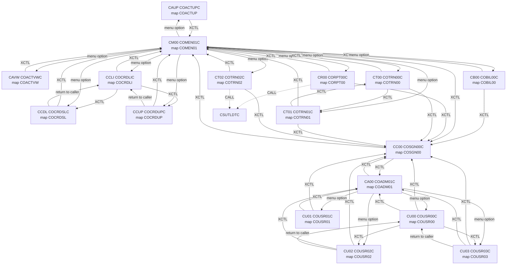
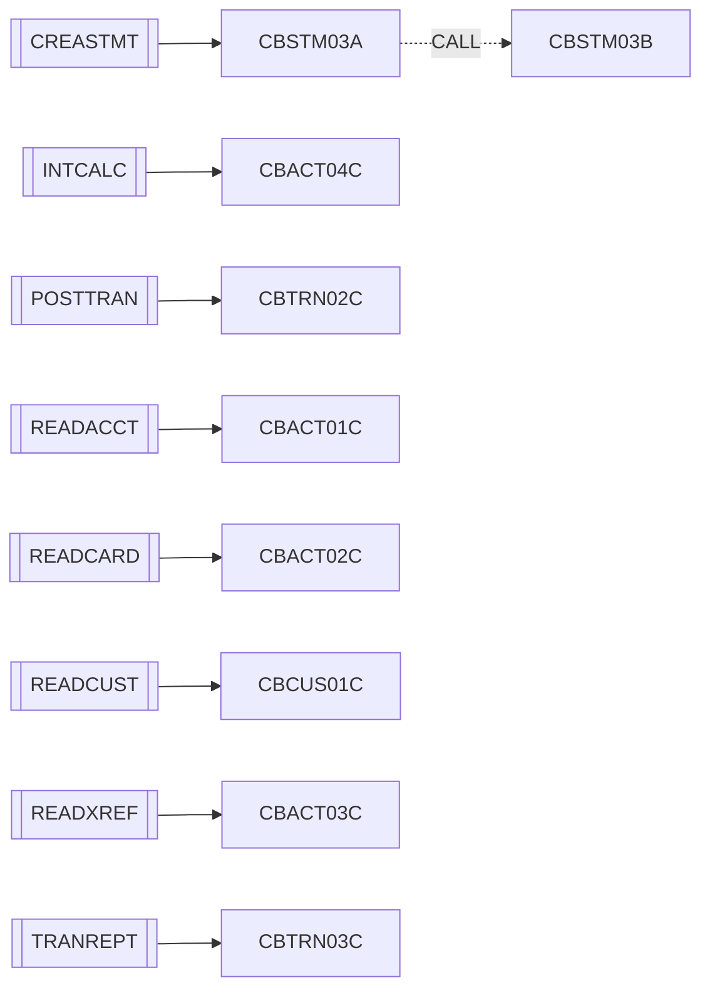

# CardDemo legacy inventory

Generated from `app/` by `docs/migration/tools/build_inventory.py` (plan step s1.2). The same data, with a `file:line` reference on every fact, is in [`inventory.json`](inventory.json). Do not edit this file by hand; re-run the generator.

## 1. Totals

| Artefact | Found | Expected (ticket) | Notes |
|---|---|---|---|
| COBOL programs (`app/cbl`) | 28 | 28 | 17 CICS, 10 batch, 1 utility |
| BMS mapsets (`app/bms`) | 17 | 17 | 17 symbolic-map copybooks in `app/cpy-bms` |
| Copybooks (`app/cpy`) | 28 | 28 |  |
| JCL jobs (`app/jcl`) | 29 | 29 | + 2 procedures in `app/proc` |
| CICS transactions (CSD) | 18 | 18 |  |
| CICS files (CSD) | 8 | 8 | 6 base clusters + 2 alternate-index paths |
| VSAM KSDS clusters (IDCAMS DEFINE in JCL) | 12 | - | 3 alternate indexes |
| CSD program definitions | 18 | - | one more than the 17 CICS sources, see finding F1 |

**Unresolved XCTL/CALL targets: 0.** Every XCTL and CALL site resolves to a program in `app/cbl` or to an IBM Language Environment service.

## 2. Findings and discrepancies

Facts below cite the source line; anything inferred is marked **Hypothesis**.

1. **F1 - CSD program without source.** CARDDEMO.CSD defines PROGRAM(COCRDSEC) 'CREDIT CARD SEARCH' ([CARDDEMO.CSD:211](../../app/csd/CARDDEMO.CSD#L211)) and TRANSACTION(CDV1) 'DEVELOPER TRANSACTION - 1' ([CARDDEMO.CSD:388](../../app/csd/CARDDEMO.CSD#L388)), but `app/cbl` has no COCRDSEC source and no program XCTLs to it. So the CSD has 18 programs / 18 transactions for 17 CICS sources. **Hypothesis:** a developer-only leftover; it should be out of scope for the migration (needs confirmation).
2. **F2 - CBADMCDJ.jcl does not match CARDDEMO.CSD.** Its DFHCSDUP input ([CBADMCDJ.jcl:27](../../app/jcl/CBADMCDJ.jcl#L27)) defines programs COACT00C, COACTDEC, COADM00C, COTRNATC, COTRNVDC, COTRNVWC, COTSTP1C, COTSTP2C, COTSTP3C, COTSTP4C that have no source, and transactions CCDM, CCT1, CCT2, CCT3, CCT4 that are not in CARDDEMO.CSD. The CSD file, not this job, is used as the authority for this inventory. **Hypothesis:** CBADMCDJ is an older/sample CSD build job.
3. **F3 - COCRDLIC PROGRAM definition carries TRANSID(CC00)** ([CARDDEMO.CSD:203](../../app/csd/CARDDEMO.CSD#L203)); CC00 is the sign-on transaction (COSGN00C). The PROGRAM TRANSID attribute only matters for DPL mirror transactions, so it has no effect on the XCTL-based flow (inference from CICS semantics).
4. **F4 - Copybooks not COPYed by any program in app/cbl:** UNUSED1Y. They are kept in the inventory for completeness.
5. **F5 - Work cluster TRXFL.** CREASTMT.JCL defines AWS.M2.CARDDEMO.TRXFL.VSAM.KSDS (key 32 = card number + transaction id, built by SORT from TRANSACT) for the statement programs CBSTM03A/CBSTM03B. It is not in LISTCAT.txt and has no CICS FILE. CBSTM03B reads it through an inline FD (FD-TRNXFILE-REC), and CBSTM03A maps it with COSTM01 (TRNX-RECORD).
6. **F6 - INTCALC passes an AIX path DD (XREFFIL1) that CBACT04C never names.** CBACT04C declares XREF-FILE with `ALTERNATE RECORD KEY IS FD-XREF-ACCT-ID` on DD XREFFILE ([CBACT04C.cbl:34](../../app/cbl/CBACT04C.cbl#L34)); INTCALC.jcl adds DD XREFFIL1 = CARDXREF.VSAM.AIX.PATH. On z/OS the alternate-index path for an ALTERNATE RECORD KEY is allocated with the base DD name truncated to 7 characters plus a digit, so XREFFIL1 belongs to XREFFILE (IBM Enterprise COBOL convention, not verified on a running system).
7. **F7 - TRANREPT batch flow is also submitted online.** CORPT00C builds JCL in WORKING-STORAGE (`//TRNRPT00 JOB`, `EXEC PROC=TRANREPT`) and writes it to TDQ JOBS ([CORPT00C.cbl:517](../../app/cbl/CORPT00C.cbl#L517)); the CSD defines TDQUEUE(JOBS) ([CARDDEMO.CSD:499](../../app/csd/CARDDEMO.CSD#L499)). The job it submits runs app/proc/TRANREPT.prc (REPROC backup, SORT, CBTRN03C). **Hypothesis:** JOBS is an extrapartition queue pointing at the JES internal reader, so the target needs a job-launch API for this screen.
8. **F8 - Programs with no JCL in app/jcl:** CBTRN01C. CBSTM03B runs only via `CALL 'CBSTM03B'` from CBSTM03A (CREASTMT step STEP040). CBTRN01C also OPENs CUSTFILE, CARDFILE, TRANFILE without ever reading them ([CBTRN01C.cbl:34](../../app/cbl/CBTRN01C.cbl#L34), [CBTRN01C.cbl:46](../../app/cbl/CBTRN01C.cbl#L46), [CBTRN01C.cbl:58](../../app/cbl/CBTRN01C.cbl#L58)). **Hypothesis:** CBTRN01C is an earlier/unused variant of the daily-transaction posting step (CBTRN02C).
9. **F9 - DEFCUST.jcl uses dataset names outside the AWS.M2.CARDDEMO HLQ** (AWS.CCDA.CUSTDATA.CLUSTER, AWS.CUSTDATA.CLUSTER; [DEFCUST.jcl:1](../../app/jcl/DEFCUST.jcl#L1)); no program, CICS FILE or other job references them, and CUSTFILE.jcl is the job that actually defines AWS.M2.CARDDEMO.CUSTDATA.VSAM.KSDS. Its cluster has KEYS(10 0) whereas CUSTDATA uses KEYS(9 0), and both its steps are named STEP05. **Hypothesis:** obsolete job.

## 3. Programs

| Program | Type | Lines | TransID | BMS mapset | Copybooks (app/cpy) | Files (CICS FILE or batch DD, access) | XCTL targets | CALL targets |
|---|---|---|---|---|---|---|---|---|
| [CBACT01C](../../app/cbl/CBACT01C.cbl) | batch (main program) | 193 | - | - | CVACT01Y | ACCTFILE (R) | - | CEE3ABD |
| [CBACT02C](../../app/cbl/CBACT02C.cbl) | batch (main program) | 178 | - | - | CVACT02Y | CARDFILE (R) | - | CEE3ABD |
| [CBACT03C](../../app/cbl/CBACT03C.cbl) | batch (main program) | 178 | - | - | CVACT03Y | XREFFILE (R) | - | CEE3ABD |
| [CBACT04C](../../app/cbl/CBACT04C.cbl) | batch (main program) | 652 | - | - | CVTRA01Y, CVACT03Y, CVTRA02Y, CVACT01Y, CVTRA05Y | TCATBALF (R), XREFFILE (R), ACCTFILE (RW), DISCGRP (R), TRANSACT (W) | - | CEE3ABD |
| [CBCUS01C](../../app/cbl/CBCUS01C.cbl) | batch (main program) | 178 | - | - | CVCUS01Y | CUSTFILE (R) | - | CEE3ABD |
| [CBSTM03A](../../app/cbl/CBSTM03A.CBL) | batch (main program) | 924 | - | - | COSTM01, CVACT03Y, CUSTREC, CVACT01Y | STMTFILE (W), HTMLFILE (W) | - | CBSTM03B, CEE3ABD |
| [CBSTM03B](../../app/cbl/CBSTM03B.CBL) | batch (called subprogram) | 230 | - | - | - | TRNXFILE (R), XREFFILE (R), CUSTFILE (R), ACCTFILE (R) | - | - |
| [CBTRN01C](../../app/cbl/CBTRN01C.cbl) | batch (main program) | 491 | - | - | CVTRA06Y, CVCUS01Y, CVACT03Y, CVACT02Y, CVACT01Y, CVTRA05Y | DALYTRAN (R), CUSTFILE (R), XREFFILE (R), CARDFILE (R), ACCTFILE (R), TRANFILE (R) | - | CEE3ABD |
| [CBTRN02C](../../app/cbl/CBTRN02C.cbl) | batch (main program) | 731 | - | - | CVTRA06Y, CVTRA05Y, CVACT03Y, CVACT01Y, CVTRA01Y | DALYTRAN (R), TRANFILE (W), XREFFILE (R), DALYREJS (W), ACCTFILE (RW), TCATBALF (RW) | - | CEE3ABD |
| [CBTRN03C](../../app/cbl/CBTRN03C.cbl) | batch (main program) | 649 | - | - | CVTRA05Y, CVACT03Y, CVTRA03Y, CVTRA04Y, CVTRA07Y | TRANFILE (R), CARDXREF (R), TRANTYPE (R), TRANCATG (R), TRANREPT (W), DATEPARM (R) | - | CEE3ABD |
| [COACTUPC](../../app/cbl/COACTUPC.cbl) | CICS | 4236 | CAUP | COACTUP | CSUTLDWY, CVCRD01Y, CSLKPCDY, COTTL01Y, CSDAT01Y, CSMSG01Y, CSMSG02Y, CSUSR01Y, CVACT01Y, CVACT03Y, CVCUS01Y, COCOM01Y, CSSETATY, CSSTRPFY, CSUTLDPY | CXACAIX (R), ACCTDAT (RW), CUSTDAT (RW) | COMEN01C | - |
| [COACTVWC](../../app/cbl/COACTVWC.cbl) | CICS | 941 | CAVW | COACTVW | CVCRD01Y, COCOM01Y, COTTL01Y, CSDAT01Y, CSMSG01Y, CSMSG02Y, CSUSR01Y, CVACT01Y, CVACT02Y, CVACT03Y, CVCUS01Y, CSSTRPFY | CXACAIX (R), ACCTDAT (R), CUSTDAT (R) | COMEN01C | - |
| [COADM01C](../../app/cbl/COADM01C.cbl) | CICS | 268 | CA00 | COADM01 | COCOM01Y, COADM02Y, COTTL01Y, CSDAT01Y, CSMSG01Y, CSUSR01Y | - | COSGN00C, COUSR00C, COUSR01C, COUSR02C, COUSR03C | - |
| [COBIL00C](../../app/cbl/COBIL00C.cbl) | CICS | 572 | CB00 | COBIL00 | COCOM01Y, COTTL01Y, CSDAT01Y, CSMSG01Y, CVACT01Y, CVACT03Y, CVTRA05Y | ACCTDAT (RW), CXACAIX (R), TRANSACT (RW) | COMEN01C, COSGN00C | - |
| [COCRDLIC](../../app/cbl/COCRDLIC.cbl) | CICS | 1459 | CCLI | COCRDLI | CVCRD01Y, COCOM01Y, COTTL01Y, CSDAT01Y, CSMSG01Y, CSUSR01Y, CVACT02Y, CSSTRPFY | CARDDAT (R) | COCRDSLC, COCRDUPC, COMEN01C | - |
| [COCRDSLC](../../app/cbl/COCRDSLC.cbl) | CICS | 887 | CCDL | COCRDSL | CVCRD01Y, COCOM01Y, COTTL01Y, CSDAT01Y, CSMSG01Y, CSMSG02Y, CSUSR01Y, CVACT02Y, CVCUS01Y, CSSTRPFY | CARDDAT (R), CARDAIX (R) | COCRDLIC, COMEN01C | - |
| [COCRDUPC](../../app/cbl/COCRDUPC.cbl) | CICS | 1560 | CCUP | COCRDUP | CVCRD01Y, COCOM01Y, COTTL01Y, CSDAT01Y, CSMSG01Y, CSMSG02Y, CSUSR01Y, CVACT02Y, CVCUS01Y, CSSTRPFY | CARDDAT (RW) | COCRDLIC, COMEN01C | - |
| [COMEN01C](../../app/cbl/COMEN01C.cbl) | CICS | 282 | CM00 | COMEN01 | COCOM01Y, COMEN02Y, COTTL01Y, CSDAT01Y, CSMSG01Y, CSUSR01Y | - | COACTUPC, COACTVWC, COBIL00C, COCRDLIC, COCRDSLC, COCRDUPC, CORPT00C, COSGN00C, COTRN00C, COTRN01C, COTRN02C | - |
| [CORPT00C](../../app/cbl/CORPT00C.cbl) | CICS | 649 | CR00 | CORPT00 | COCOM01Y, COTTL01Y, CSDAT01Y, CSMSG01Y, CVTRA05Y | - | COMEN01C, COSGN00C | CSUTLDTC |
| [COSGN00C](../../app/cbl/COSGN00C.cbl) | CICS | 260 | CC00 | COSGN00 | COCOM01Y, COTTL01Y, CSDAT01Y, CSMSG01Y, CSUSR01Y | USRSEC (R) | COADM01C, COMEN01C | - |
| [COTRN00C](../../app/cbl/COTRN00C.cbl) | CICS | 699 | CT00 | COTRN00 | COCOM01Y, COTTL01Y, CSDAT01Y, CSMSG01Y, CVTRA05Y | TRANSACT (R) | COMEN01C, COSGN00C, COTRN01C | - |
| [COTRN01C](../../app/cbl/COTRN01C.cbl) | CICS | 330 | CT01 | COTRN01 | COCOM01Y, COTTL01Y, CSDAT01Y, CSMSG01Y, CVTRA05Y | TRANSACT (R) | COMEN01C, COSGN00C, COTRN00C | - |
| [COTRN02C](../../app/cbl/COTRN02C.cbl) | CICS | 783 | CT02 | COTRN02 | COCOM01Y, COTTL01Y, CSDAT01Y, CSMSG01Y, CVTRA05Y, CVACT01Y, CVACT03Y | CXACAIX (R), CCXREF (R), TRANSACT (RW) | COMEN01C, COSGN00C | CSUTLDTC |
| [COUSR00C](../../app/cbl/COUSR00C.cbl) | CICS | 695 | CU00 | COUSR00 | COCOM01Y, COTTL01Y, CSDAT01Y, CSMSG01Y, CSUSR01Y | USRSEC (R) | COADM01C, COSGN00C, COUSR02C, COUSR03C | - |
| [COUSR01C](../../app/cbl/COUSR01C.cbl) | CICS | 299 | CU01 | COUSR01 | COCOM01Y, COTTL01Y, CSDAT01Y, CSMSG01Y, CSUSR01Y | USRSEC (RW) | COADM01C, COSGN00C | - |
| [COUSR02C](../../app/cbl/COUSR02C.cbl) | CICS | 414 | CU02 | COUSR02 | COCOM01Y, COTTL01Y, CSDAT01Y, CSMSG01Y, CSUSR01Y | USRSEC (RW) | COADM01C, COSGN00C, COUSR00C | - |
| [COUSR03C](../../app/cbl/COUSR03C.cbl) | CICS | 359 | CU03 | COUSR03 | COCOM01Y, COTTL01Y, CSDAT01Y, CSMSG01Y, CSUSR01Y | USRSEC (RW) | COADM01C, COSGN00C, COUSR00C | - |
| [CSUTLDTC](../../app/cbl/CSUTLDTC.cbl) | utility (called subprogram) | 157 | - | - | - | - | - | CEEDAYS |

Access: R = read/browse only, W = write only (OPEN OUTPUT), RW = read and write/rewrite/delete. BMS symbolic-map copybooks (`app/cpy-bms`) and CICS system copybooks (DFHAID, DFHBMSCA) are listed per program in the JSON.

### 3.1 Online file access (CICS)

| Program | CICS file | EXEC CICS commands | Record copybook | Source |
|---|---|---|---|---|
| COACTUPC | CXACAIX | READ | CVACT03Y | [COACTUPC.cbl:3654](../../app/cbl/COACTUPC.cbl#L3654) |
| COACTUPC | ACCTDAT | READ, READ UPDATE, REWRITE | CVACT01Y, inline ACCT-UPDATE-RECORD | [COACTUPC.cbl:3703](../../app/cbl/COACTUPC.cbl#L3703) [COACTUPC.cbl:3894](../../app/cbl/COACTUPC.cbl#L3894) [COACTUPC.cbl:4065](../../app/cbl/COACTUPC.cbl#L4065) |
| COACTUPC | CUSTDAT | READ, READ UPDATE, REWRITE | CVCUS01Y, inline CUST-UPDATE-RECORD | [COACTUPC.cbl:3753](../../app/cbl/COACTUPC.cbl#L3753) [COACTUPC.cbl:3921](../../app/cbl/COACTUPC.cbl#L3921) [COACTUPC.cbl:4085](../../app/cbl/COACTUPC.cbl#L4085) |
| COACTVWC | CXACAIX | READ | CVACT03Y | [COACTVWC.cbl:727](../../app/cbl/COACTVWC.cbl#L727) |
| COACTVWC | ACCTDAT | READ | CVACT01Y | [COACTVWC.cbl:776](../../app/cbl/COACTVWC.cbl#L776) |
| COACTVWC | CUSTDAT | READ | CVCUS01Y | [COACTVWC.cbl:826](../../app/cbl/COACTVWC.cbl#L826) |
| COBIL00C | ACCTDAT | READ UPDATE, REWRITE | CVACT01Y | [COBIL00C.cbl:345](../../app/cbl/COBIL00C.cbl#L345) [COBIL00C.cbl:379](../../app/cbl/COBIL00C.cbl#L379) |
| COBIL00C | CXACAIX | READ | CVACT03Y | [COBIL00C.cbl:410](../../app/cbl/COBIL00C.cbl#L410) |
| COBIL00C | TRANSACT | STARTBR, READPREV, ENDBR, WRITE | CVTRA05Y | [COBIL00C.cbl:443](../../app/cbl/COBIL00C.cbl#L443) [COBIL00C.cbl:474](../../app/cbl/COBIL00C.cbl#L474) [COBIL00C.cbl:503](../../app/cbl/COBIL00C.cbl#L503) [COBIL00C.cbl:512](../../app/cbl/COBIL00C.cbl#L512) |
| COCRDLIC | CARDDAT | STARTBR, READNEXT, ENDBR, READPREV | CVACT02Y | [COCRDLIC.cbl:1129](../../app/cbl/COCRDLIC.cbl#L1129) [COCRDLIC.cbl:1146](../../app/cbl/COCRDLIC.cbl#L1146) [COCRDLIC.cbl:1197](../../app/cbl/COCRDLIC.cbl#L1197) [COCRDLIC.cbl:1258](../../app/cbl/COCRDLIC.cbl#L1258) ... |
| COCRDSLC | CARDDAT | READ | CVACT02Y | [COCRDSLC.cbl:742](../../app/cbl/COCRDSLC.cbl#L742) |
| COCRDSLC | CARDAIX | READ | CVACT02Y | [COCRDSLC.cbl:783](../../app/cbl/COCRDSLC.cbl#L783) |
| COCRDUPC | CARDDAT | READ, READ UPDATE, REWRITE | CVACT02Y, inline CARD-UPDATE-RECORD | [COCRDUPC.cbl:1382](../../app/cbl/COCRDUPC.cbl#L1382) [COCRDUPC.cbl:1427](../../app/cbl/COCRDUPC.cbl#L1427) [COCRDUPC.cbl:1477](../../app/cbl/COCRDUPC.cbl#L1477) |
| COSGN00C | USRSEC | READ | CSUSR01Y | [COSGN00C.cbl:211](../../app/cbl/COSGN00C.cbl#L211) |
| COTRN00C | TRANSACT | STARTBR, READNEXT, READPREV, ENDBR | CVTRA05Y | [COTRN00C.cbl:593](../../app/cbl/COTRN00C.cbl#L593) [COTRN00C.cbl:626](../../app/cbl/COTRN00C.cbl#L626) [COTRN00C.cbl:660](../../app/cbl/COTRN00C.cbl#L660) [COTRN00C.cbl:694](../../app/cbl/COTRN00C.cbl#L694) |
| COTRN01C | TRANSACT | READ UPDATE | CVTRA05Y | [COTRN01C.cbl:269](../../app/cbl/COTRN01C.cbl#L269) |
| COTRN02C | CXACAIX | READ | CVACT03Y | [COTRN02C.cbl:578](../../app/cbl/COTRN02C.cbl#L578) |
| COTRN02C | CCXREF | READ | CVACT03Y | [COTRN02C.cbl:611](../../app/cbl/COTRN02C.cbl#L611) |
| COTRN02C | TRANSACT | STARTBR, READPREV, ENDBR, WRITE | CVTRA05Y | [COTRN02C.cbl:644](../../app/cbl/COTRN02C.cbl#L644) [COTRN02C.cbl:675](../../app/cbl/COTRN02C.cbl#L675) [COTRN02C.cbl:704](../../app/cbl/COTRN02C.cbl#L704) [COTRN02C.cbl:713](../../app/cbl/COTRN02C.cbl#L713) |
| COUSR00C | USRSEC | STARTBR, READNEXT, READPREV, ENDBR | CSUSR01Y | [COUSR00C.cbl:588](../../app/cbl/COUSR00C.cbl#L588) [COUSR00C.cbl:621](../../app/cbl/COUSR00C.cbl#L621) [COUSR00C.cbl:655](../../app/cbl/COUSR00C.cbl#L655) [COUSR00C.cbl:689](../../app/cbl/COUSR00C.cbl#L689) |
| COUSR01C | USRSEC | WRITE | CSUSR01Y | [COUSR01C.cbl:240](../../app/cbl/COUSR01C.cbl#L240) |
| COUSR02C | USRSEC | READ UPDATE, REWRITE | CSUSR01Y | [COUSR02C.cbl:322](../../app/cbl/COUSR02C.cbl#L322) [COUSR02C.cbl:360](../../app/cbl/COUSR02C.cbl#L360) |
| COUSR03C | USRSEC | READ UPDATE, DELETE | CSUSR01Y | [COUSR03C.cbl:269](../../app/cbl/COUSR03C.cbl#L269) [COUSR03C.cbl:307](../../app/cbl/COUSR03C.cbl#L307) |

### 3.2 Batch file access (SELECT/ASSIGN, OPEN mode, JCL DD)

| Program | SELECT | DD | Org/access | OPEN | Verbs | Record copybook | Dataset (via JCL) | Source |
|---|---|---|---|---|---|---|---|---|
| CBACT01C | ACCTFILE-FILE | ACCTFILE | INDEXED/R | INPUT | READ | CVACT01Y | ACCTDATA.VSAM.KSDS | [CBACT01C.cbl:29](../../app/cbl/CBACT01C.cbl#L29) |
| CBACT02C | CARDFILE-FILE | CARDFILE | INDEXED/R | INPUT | READ | CVACT02Y | CARDDATA.VSAM.KSDS | [CBACT02C.cbl:29](../../app/cbl/CBACT02C.cbl#L29) |
| CBACT03C | XREFFILE-FILE | XREFFILE | INDEXED/R | INPUT | READ | CVACT03Y | CARDXREF.VSAM.KSDS | [CBACT03C.cbl:29](../../app/cbl/CBACT03C.cbl#L29) |
| CBACT04C | TCATBAL-FILE | TCATBALF | INDEXED/R | INPUT | READ | CVTRA01Y | TCATBALF.VSAM.KSDS | [CBACT04C.cbl:28](../../app/cbl/CBACT04C.cbl#L28) |
| CBACT04C | XREF-FILE | XREFFILE | INDEXED/R | INPUT | READ | CVACT03Y | CARDXREF.VSAM.KSDS | [CBACT04C.cbl:34](../../app/cbl/CBACT04C.cbl#L34) |
| CBACT04C | ACCOUNT-FILE | ACCTFILE | INDEXED/RW | I-O | REWRITE, READ | CVACT01Y | ACCTDATA.VSAM.KSDS | [CBACT04C.cbl:41](../../app/cbl/CBACT04C.cbl#L41) |
| CBACT04C | DISCGRP-FILE | DISCGRP | INDEXED/R | INPUT | READ | CVTRA02Y | DISCGRP.VSAM.KSDS | [CBACT04C.cbl:47](../../app/cbl/CBACT04C.cbl#L47) |
| CBACT04C | TRANSACT-FILE | TRANSACT | SEQUENTIAL/W | OUTPUT | WRITE | CVTRA05Y | SYSTRAN(+1) | [CBACT04C.cbl:53](../../app/cbl/CBACT04C.cbl#L53) |
| CBCUS01C | CUSTFILE-FILE | CUSTFILE | INDEXED/R | INPUT | READ | CVCUS01Y | CUSTDATA.VSAM.KSDS | [CBCUS01C.cbl:29](../../app/cbl/CBCUS01C.cbl#L29) |
| CBSTM03A | STMT-FILE | STMTFILE | SEQUENTIAL/W | OUTPUT | WRITE | 17 inline WORKING-STORAGE/LINKAGE records | STATEMNT.PS | [CBSTM03A.CBL:39](../../app/cbl/CBSTM03A.CBL#L39) |
| CBSTM03A | HTML-FILE | HTMLFILE | SEQUENTIAL/W | OUTPUT | WRITE | 5 inline WORKING-STORAGE/LINKAGE records | STATEMNT.HTML | [CBSTM03A.CBL:40](../../app/cbl/CBSTM03A.CBL#L40) |
| CBSTM03B | TRNX-FILE | TRNXFILE | INDEXED/R | INPUT | READ | inline LK-M03B-FLDT | TRXFL.VSAM.KSDS | [CBSTM03B.CBL:31](../../app/cbl/CBSTM03B.CBL#L31) |
| CBSTM03B | XREF-FILE | XREFFILE | INDEXED/R | INPUT | READ | inline LK-M03B-FLDT | CARDXREF.VSAM.KSDS | [CBSTM03B.CBL:37](../../app/cbl/CBSTM03B.CBL#L37) |
| CBSTM03B | CUST-FILE | CUSTFILE | INDEXED/R | INPUT | READ | inline LK-M03B-FLDT | CUSTDATA.VSAM.KSDS | [CBSTM03B.CBL:43](../../app/cbl/CBSTM03B.CBL#L43) |
| CBSTM03B | ACCT-FILE | ACCTFILE | INDEXED/R | INPUT | READ | inline LK-M03B-FLDT | ACCTDATA.VSAM.KSDS | [CBSTM03B.CBL:49](../../app/cbl/CBSTM03B.CBL#L49) |
| CBTRN01C | DALYTRAN-FILE | DALYTRAN | SEQUENTIAL/R | INPUT | READ | CVTRA06Y | - | [CBTRN01C.cbl:29](../../app/cbl/CBTRN01C.cbl#L29) |
| CBTRN01C | CUSTOMER-FILE | CUSTFILE | INDEXED/R | INPUT |  | - | - | [CBTRN01C.cbl:34](../../app/cbl/CBTRN01C.cbl#L34) |
| CBTRN01C | XREF-FILE | XREFFILE | INDEXED/R | INPUT | READ | CVACT03Y | - | [CBTRN01C.cbl:40](../../app/cbl/CBTRN01C.cbl#L40) |
| CBTRN01C | CARD-FILE | CARDFILE | INDEXED/R | INPUT |  | - | - | [CBTRN01C.cbl:46](../../app/cbl/CBTRN01C.cbl#L46) |
| CBTRN01C | ACCOUNT-FILE | ACCTFILE | INDEXED/R | INPUT | READ | CVACT01Y | - | [CBTRN01C.cbl:52](../../app/cbl/CBTRN01C.cbl#L52) |
| CBTRN01C | TRANSACT-FILE | TRANFILE | INDEXED/R | INPUT |  | - | - | [CBTRN01C.cbl:58](../../app/cbl/CBTRN01C.cbl#L58) |
| CBTRN02C | DALYTRAN-FILE | DALYTRAN | SEQUENTIAL/R | INPUT | READ | CVTRA06Y | DALYTRAN.PS | [CBTRN02C.cbl:29](../../app/cbl/CBTRN02C.cbl#L29) |
| CBTRN02C | TRANSACT-FILE | TRANFILE | INDEXED/W | OUTPUT | WRITE | CVTRA05Y | TRANSACT.VSAM.KSDS | [CBTRN02C.cbl:34](../../app/cbl/CBTRN02C.cbl#L34) |
| CBTRN02C | XREF-FILE | XREFFILE | INDEXED/R | INPUT | READ | CVACT03Y | CARDXREF.VSAM.KSDS | [CBTRN02C.cbl:40](../../app/cbl/CBTRN02C.cbl#L40) |
| CBTRN02C | DALYREJS-FILE | DALYREJS | SEQUENTIAL/W | OUTPUT | WRITE | inline REJECT-RECORD | DALYREJS(+1) | [CBTRN02C.cbl:46](../../app/cbl/CBTRN02C.cbl#L46) |
| CBTRN02C | ACCOUNT-FILE | ACCTFILE | INDEXED/RW | I-O | READ, REWRITE | CVACT01Y | ACCTDATA.VSAM.KSDS | [CBTRN02C.cbl:51](../../app/cbl/CBTRN02C.cbl#L51) |
| CBTRN02C | TCATBAL-FILE | TCATBALF | INDEXED/RW | I-O | READ, WRITE, REWRITE | CVTRA01Y | TCATBALF.VSAM.KSDS | [CBTRN02C.cbl:57](../../app/cbl/CBTRN02C.cbl#L57) |
| CBTRN03C | TRANSACT-FILE | TRANFILE | SEQUENTIAL/R | INPUT | READ | CVTRA05Y | TRANSACT.DALY(+1) | [CBTRN03C.cbl:29](../../app/cbl/CBTRN03C.cbl#L29) |
| CBTRN03C | XREF-FILE | CARDXREF | INDEXED/R | INPUT | READ | CVACT03Y | CARDXREF.VSAM.KSDS | [CBTRN03C.cbl:33](../../app/cbl/CBTRN03C.cbl#L33) |
| CBTRN03C | TRANTYPE-FILE | TRANTYPE | INDEXED/R | INPUT | READ | CVTRA03Y | TRANTYPE.VSAM.KSDS | [CBTRN03C.cbl:39](../../app/cbl/CBTRN03C.cbl#L39) |
| CBTRN03C | TRANCATG-FILE | TRANCATG | INDEXED/R | INPUT | READ | CVTRA04Y | TRANCATG.VSAM.KSDS | [CBTRN03C.cbl:45](../../app/cbl/CBTRN03C.cbl#L45) |
| CBTRN03C | REPORT-FILE | TRANREPT | SEQUENTIAL/W | OUTPUT | WRITE | - | TRANREPT(+1) | [CBTRN03C.cbl:51](../../app/cbl/CBTRN03C.cbl#L51) |
| CBTRN03C | DATE-PARMS-FILE | DATEPARM | SEQUENTIAL/R | INPUT | READ | inline WS-DATEPARM-RECORD | DATEPARM | [CBTRN03C.cbl:55](../../app/cbl/CBTRN03C.cbl#L55) |

### 3.3 XCTL and CALL resolution

Rules used (applied by the generator and spot-checked by hand):

- `XCTL PROGRAM('LIT')` or a `PIC X VALUE 'LIT'` constant (e.g. `LIT-MENUPGM`): taken literally.
- `XCTL PROGRAM(CDEMO-MENU-OPT-PGMNAME(WS-OPTION))` (COMEN01C) and `CDEMO-ADMIN-OPT-PGMNAME(WS-OPTION)` (COADM01C): every row of the option table in COMEN02Y / COADM02Y.
- `XCTL PROGRAM(CDEMO-TO-PROGRAM)`: every `MOVE <literal|constant> TO CDEMO-TO-PROGRAM` in the same program (the shared RETURN-TO-PREV-SCREEN pattern sets it before PERFORMing the XCTL paragraph). Where the program also does `MOVE CDEMO-FROM-PROGRAM TO CDEMO-TO-PROGRAM` (return to caller), the target set is extended with every program that XCTLs to it.
- `XCTL PROGRAM(CCARD-NEXT-PROG)` (COCRDLIC): the nearest preceding MOVE in the same paragraph.
- `CALL 'X'`: in-repo program if `app/cbl` has it, otherwise an IBM Language Environment callable service (CEE3ABD, CEEDAYS). No dynamic CALL and no EXEC CICS LINK/START exists in `app/cbl`.

| Program | Site | Expression | Resolved targets |
|---|---|---|---|
| CBACT01C | [CBACT01C.cbl:173](../../app/cbl/CBACT01C.cbl#L173) | `CALL 'CEE3ABD'` | CEE3ABD - external (IBM Language Environment callable service: abend the enclave) |
| CBACT02C | [CBACT02C.cbl:158](../../app/cbl/CBACT02C.cbl#L158) | `CALL 'CEE3ABD'` | CEE3ABD - external (IBM Language Environment callable service: abend the enclave) |
| CBACT03C | [CBACT03C.cbl:158](../../app/cbl/CBACT03C.cbl#L158) | `CALL 'CEE3ABD'` | CEE3ABD - external (IBM Language Environment callable service: abend the enclave) |
| CBACT04C | [CBACT04C.cbl:632](../../app/cbl/CBACT04C.cbl#L632) | `CALL 'CEE3ABD'` | CEE3ABD - external (IBM Language Environment callable service: abend the enclave) |
| CBCUS01C | [CBCUS01C.cbl:158](../../app/cbl/CBCUS01C.cbl#L158) | `CALL 'CEE3ABD'` | CEE3ABD - external (IBM Language Environment callable service: abend the enclave) |
| CBSTM03A | [CBSTM03A.CBL:351](../../app/cbl/CBSTM03A.CBL#L351) [CBSTM03A.CBL:377](../../app/cbl/CBSTM03A.CBL#L377) ... | `CALL 'CBSTM03B'` | CBSTM03B - in-repo program |
| CBSTM03A | [CBSTM03A.CBL:923](../../app/cbl/CBSTM03A.CBL#L923) | `CALL 'CEE3ABD'` | CEE3ABD - external (IBM Language Environment callable service: abend the enclave) |
| CBTRN01C | [CBTRN01C.cbl:473](../../app/cbl/CBTRN01C.cbl#L473) | `CALL 'CEE3ABD'` | CEE3ABD - external (IBM Language Environment callable service: abend the enclave) |
| CBTRN02C | [CBTRN02C.cbl:711](../../app/cbl/CBTRN02C.cbl#L711) | `CALL 'CEE3ABD'` | CEE3ABD - external (IBM Language Environment callable service: abend the enclave) |
| CBTRN03C | [CBTRN03C.cbl:630](../../app/cbl/CBTRN03C.cbl#L630) | `CALL 'CEE3ABD'` | CEE3ABD - external (IBM Language Environment callable service: abend the enclave) |
| COACTUPC | [COACTUPC.cbl:956](../../app/cbl/COACTUPC.cbl#L956) | `CDEMO-TO-PROGRAM` | COMEN01C - MOVE LIT-MENUPGM TO CDEMO-TO-PROGRAM |
| COACTVWC | [COACTVWC.cbl:349](../../app/cbl/COACTVWC.cbl#L349) | `CDEMO-TO-PROGRAM` | COMEN01C - MOVE LIT-MENUPGM TO CDEMO-TO-PROGRAM |
| COADM01C | [COADM01C.cbl:142](../../app/cbl/COADM01C.cbl#L142) | `CDEMO-ADMIN-OPT-PGMNAME(WS-OPTION)` | COUSR00C - COADM02Y option 1 'USER LIST (SECURITY)' COUSR01C - COADM02Y option 2 'USER ADD (SECURITY)' COUSR02C - COADM02Y option 3 'USER UPDATE (SECURITY)' COUSR03C - COADM02Y option 4 'USER DELETE (SECURITY)' |
| COADM01C | [COADM01C.cbl:165](../../app/cbl/COADM01C.cbl#L165) | `CDEMO-TO-PROGRAM` | COSGN00C - MOVE 'COSGN00C' TO CDEMO-TO-PROGRAM |
| COBIL00C | [COBIL00C.cbl:281](../../app/cbl/COBIL00C.cbl#L281) | `CDEMO-TO-PROGRAM` | COSGN00C - MOVE 'COSGN00C' TO CDEMO-TO-PROGRAM COMEN01C - MOVE 'COMEN01C' TO CDEMO-TO-PROGRAM |
| COCRDLIC | [COCRDLIC.cbl:402](../../app/cbl/COCRDLIC.cbl#L402) | `LIT-MENUPGM` | COMEN01C - constant LIT-MENUPGM |
| COCRDLIC | [COCRDLIC.cbl:538](../../app/cbl/COCRDLIC.cbl#L538) | `CCARD-NEXT-PROG` | COCRDSLC - MOVE LIT-CARDDTLPGM TO CCARD-NEXT-PROG (app/cbl/COCRDLIC.cbl:526) -> constant LIT-CARDDTLPGM |
| COCRDLIC | [COCRDLIC.cbl:566](../../app/cbl/COCRDLIC.cbl#L566) | `CCARD-NEXT-PROG` | COCRDUPC - MOVE LIT-CARDUPDPGM TO CCARD-NEXT-PROG (app/cbl/COCRDLIC.cbl:554) -> constant LIT-CARDUPDPGM |
| COCRDSLC | [COCRDSLC.cbl:331](../../app/cbl/COCRDSLC.cbl#L331) | `CDEMO-TO-PROGRAM` | COMEN01C - MOVE LIT-MENUPGM TO CDEMO-TO-PROGRAM COCRDLIC - CDEMO-FROM-PROGRAM = calling program (COCRDLIC XCTLs to COCRDSLC) |
| COCRDUPC | [COCRDUPC.cbl:473](../../app/cbl/COCRDUPC.cbl#L473) | `CDEMO-TO-PROGRAM` | COMEN01C - MOVE LIT-MENUPGM TO CDEMO-TO-PROGRAM COCRDLIC - CDEMO-FROM-PROGRAM = calling program (COCRDLIC XCTLs to COCRDUPC) |
| COMEN01C | [COMEN01C.cbl:152](../../app/cbl/COMEN01C.cbl#L152) | `CDEMO-MENU-OPT-PGMNAME(WS-OPTION)` | COACTVWC - COMEN02Y option 1 'ACCOUNT VIEW' COACTUPC - COMEN02Y option 2 'ACCOUNT UPDATE' COCRDLIC - COMEN02Y option 3 'CREDIT CARD LIST' COCRDSLC - COMEN02Y option 4 'CREDIT CARD VIEW' COCRDUPC - COMEN02Y option 5 'CREDIT CARD UPDATE' COTRN00C - COMEN02Y option 6 'TRANSACTION LIST' COTRN01C - COMEN02Y option 7 'TRANSACTION VIEW' COTRN02C - COMEN02Y option 8 'TRANSACTION ADD' CORPT00C - COMEN02Y option 9 'TRANSACTION REPORTS' COBIL00C - COMEN02Y option 10 'BILL PAYMENT' |
| COMEN01C | [COMEN01C.cbl:175](../../app/cbl/COMEN01C.cbl#L175) | `CDEMO-TO-PROGRAM` | COSGN00C - MOVE 'COSGN00C' TO CDEMO-TO-PROGRAM |
| CORPT00C | [CORPT00C.cbl:548](../../app/cbl/CORPT00C.cbl#L548) | `CDEMO-TO-PROGRAM` | COSGN00C - MOVE 'COSGN00C' TO CDEMO-TO-PROGRAM COMEN01C - MOVE 'COMEN01C' TO CDEMO-TO-PROGRAM |
| CORPT00C | [CORPT00C.cbl:392](../../app/cbl/CORPT00C.cbl#L392) [CORPT00C.cbl:412](../../app/cbl/CORPT00C.cbl#L412) | `CALL 'CSUTLDTC'` | CSUTLDTC - in-repo program |
| COSGN00C | [COSGN00C.cbl:231](../../app/cbl/COSGN00C.cbl#L231) | `'COADM01C'` | COADM01C - literal |
| COSGN00C | [COSGN00C.cbl:236](../../app/cbl/COSGN00C.cbl#L236) | `'COMEN01C'` | COMEN01C - literal |
| COTRN00C | [COTRN00C.cbl:192](../../app/cbl/COTRN00C.cbl#L192) | `CDEMO-TO-PROGRAM` | COSGN00C - MOVE 'COSGN00C' TO CDEMO-TO-PROGRAM COMEN01C - MOVE 'COMEN01C' TO CDEMO-TO-PROGRAM COTRN01C - MOVE 'COTRN01C' TO CDEMO-TO-PROGRAM |
| COTRN00C | [COTRN00C.cbl:518](../../app/cbl/COTRN00C.cbl#L518) | `CDEMO-TO-PROGRAM` | COSGN00C - MOVE 'COSGN00C' TO CDEMO-TO-PROGRAM COMEN01C - MOVE 'COMEN01C' TO CDEMO-TO-PROGRAM COTRN01C - MOVE 'COTRN01C' TO CDEMO-TO-PROGRAM |
| COTRN01C | [COTRN01C.cbl:205](../../app/cbl/COTRN01C.cbl#L205) | `CDEMO-TO-PROGRAM` | COSGN00C - MOVE 'COSGN00C' TO CDEMO-TO-PROGRAM COMEN01C - MOVE 'COMEN01C' TO CDEMO-TO-PROGRAM COTRN00C - MOVE 'COTRN00C' TO CDEMO-TO-PROGRAM |
| COTRN02C | [COTRN02C.cbl:508](../../app/cbl/COTRN02C.cbl#L508) | `CDEMO-TO-PROGRAM` | COSGN00C - MOVE 'COSGN00C' TO CDEMO-TO-PROGRAM COMEN01C - MOVE 'COMEN01C' TO CDEMO-TO-PROGRAM |
| COTRN02C | [COTRN02C.cbl:393](../../app/cbl/COTRN02C.cbl#L393) [COTRN02C.cbl:413](../../app/cbl/COTRN02C.cbl#L413) | `CALL 'CSUTLDTC'` | CSUTLDTC - in-repo program |
| COUSR00C | [COUSR00C.cbl:196](../../app/cbl/COUSR00C.cbl#L196) | `CDEMO-TO-PROGRAM` | COSGN00C - MOVE 'COSGN00C' TO CDEMO-TO-PROGRAM COADM01C - MOVE 'COADM01C' TO CDEMO-TO-PROGRAM COUSR02C - MOVE 'COUSR02C' TO CDEMO-TO-PROGRAM COUSR03C - MOVE 'COUSR03C' TO CDEMO-TO-PROGRAM |
| COUSR00C | [COUSR00C.cbl:206](../../app/cbl/COUSR00C.cbl#L206) | `CDEMO-TO-PROGRAM` | COSGN00C - MOVE 'COSGN00C' TO CDEMO-TO-PROGRAM COADM01C - MOVE 'COADM01C' TO CDEMO-TO-PROGRAM COUSR02C - MOVE 'COUSR02C' TO CDEMO-TO-PROGRAM COUSR03C - MOVE 'COUSR03C' TO CDEMO-TO-PROGRAM |
| COUSR00C | [COUSR00C.cbl:514](../../app/cbl/COUSR00C.cbl#L514) | `CDEMO-TO-PROGRAM` | COSGN00C - MOVE 'COSGN00C' TO CDEMO-TO-PROGRAM COADM01C - MOVE 'COADM01C' TO CDEMO-TO-PROGRAM COUSR02C - MOVE 'COUSR02C' TO CDEMO-TO-PROGRAM COUSR03C - MOVE 'COUSR03C' TO CDEMO-TO-PROGRAM |
| COUSR01C | [COUSR01C.cbl:175](../../app/cbl/COUSR01C.cbl#L175) | `CDEMO-TO-PROGRAM` | COSGN00C - MOVE 'COSGN00C' TO CDEMO-TO-PROGRAM COADM01C - MOVE 'COADM01C' TO CDEMO-TO-PROGRAM |
| COUSR02C | [COUSR02C.cbl:258](../../app/cbl/COUSR02C.cbl#L258) | `CDEMO-TO-PROGRAM` | COSGN00C - MOVE 'COSGN00C' TO CDEMO-TO-PROGRAM COADM01C - MOVE 'COADM01C' TO CDEMO-TO-PROGRAM COUSR00C - CDEMO-FROM-PROGRAM = calling program (COUSR00C XCTLs to COUSR02C) |
| COUSR03C | [COUSR03C.cbl:205](../../app/cbl/COUSR03C.cbl#L205) | `CDEMO-TO-PROGRAM` | COSGN00C - MOVE 'COSGN00C' TO CDEMO-TO-PROGRAM COADM01C - MOVE 'COADM01C' TO CDEMO-TO-PROGRAM COUSR00C - CDEMO-FROM-PROGRAM = calling program (COUSR00C XCTLs to COUSR03C) |
| CSUTLDTC | [CSUTLDTC.cbl:116](../../app/cbl/CSUTLDTC.cbl#L116) | `CALL 'CEEDAYS'` | CEEDAYS - external (IBM Language Environment callable service: date to Lilian day number) |

## 4. CICS transactions

| TransID | Program | BMS mapset | Source in app/cbl | CSD description | CSD |
|---|---|---|---|---|---|
| CAUP | COACTUPC | COACTUP | yes | CREDIT CARD DEMO ACCOUNT UPDATE | [CARDDEMO.CSD:306](../../app/csd/CARDDEMO.CSD#L306) |
| CAVW | COACTVWC | COACTVW | yes | - | [CARDDEMO.CSD:317](../../app/csd/CARDDEMO.CSD#L317) |
| CA00 | COADM01C | COADM01 | yes | - | [CARDDEMO.CSD:327](../../app/csd/CARDDEMO.CSD#L327) |
| CB00 | COBIL00C | COBIL00 | yes | - | [CARDDEMO.CSD:337](../../app/csd/CARDDEMO.CSD#L337) |
| CCDL | COCRDSLC | COCRDSL | yes | - | [CARDDEMO.CSD:347](../../app/csd/CARDDEMO.CSD#L347) |
| CCLI | COCRDLIC | COCRDLI | yes | - | [CARDDEMO.CSD:357](../../app/csd/CARDDEMO.CSD#L357) |
| CCUP | COCRDUPC | COCRDUP | yes | CREDIT CARD UPDATE TRANSACTION | [CARDDEMO.CSD:367](../../app/csd/CARDDEMO.CSD#L367) |
| CC00 | COSGN00C | COSGN00 | yes | - | [CARDDEMO.CSD:378](../../app/csd/CARDDEMO.CSD#L378) |
| CDV1 | COCRDSEC | - | **no source** | DEVELOPER TRANSACTION - 1 | [CARDDEMO.CSD:388](../../app/csd/CARDDEMO.CSD#L388) |
| CM00 | COMEN01C | COMEN01 | yes | - | [CARDDEMO.CSD:399](../../app/csd/CARDDEMO.CSD#L399) |
| CR00 | CORPT00C | CORPT00 | yes | - | [CARDDEMO.CSD:409](../../app/csd/CARDDEMO.CSD#L409) |
| CT00 | COTRN00C | COTRN00 | yes | - | [CARDDEMO.CSD:419](../../app/csd/CARDDEMO.CSD#L419) |
| CT01 | COTRN01C | COTRN01 | yes | - | [CARDDEMO.CSD:429](../../app/csd/CARDDEMO.CSD#L429) |
| CT02 | COTRN02C | COTRN02 | yes | - | [CARDDEMO.CSD:439](../../app/csd/CARDDEMO.CSD#L439) |
| CU00 | COUSR00C | COUSR00 | yes | - | [CARDDEMO.CSD:449](../../app/csd/CARDDEMO.CSD#L449) |
| CU01 | COUSR01C | COUSR01 | yes | - | [CARDDEMO.CSD:459](../../app/csd/CARDDEMO.CSD#L459) |
| CU02 | COUSR02C | COUSR02 | yes | - | [CARDDEMO.CSD:469](../../app/csd/CARDDEMO.CSD#L469) |
| CU03 | COUSR03C | COUSR03 | yes | - | [CARDDEMO.CSD:479](../../app/csd/CARDDEMO.CSD#L479) |

Main menu (COMEN02Y) and admin menu (COADM02Y) options, which drive the menu XCTLs:

| Option | Label | Program | User type | Source |
|---|---|---|---|---|
| main 1 | ACCOUNT VIEW | COACTVWC | U | [COMEN02Y.cpy:25](../../app/cpy/COMEN02Y.cpy#L25) |
| main 2 | ACCOUNT UPDATE | COACTUPC | U | [COMEN02Y.cpy:31](../../app/cpy/COMEN02Y.cpy#L31) |
| main 3 | CREDIT CARD LIST | COCRDLIC | U | [COMEN02Y.cpy:37](../../app/cpy/COMEN02Y.cpy#L37) |
| main 4 | CREDIT CARD VIEW | COCRDSLC | U | [COMEN02Y.cpy:43](../../app/cpy/COMEN02Y.cpy#L43) |
| main 5 | CREDIT CARD UPDATE | COCRDUPC | U | [COMEN02Y.cpy:49](../../app/cpy/COMEN02Y.cpy#L49) |
| main 6 | TRANSACTION LIST | COTRN00C | U | [COMEN02Y.cpy:55](../../app/cpy/COMEN02Y.cpy#L55) |
| main 7 | TRANSACTION VIEW | COTRN01C | U | [COMEN02Y.cpy:61](../../app/cpy/COMEN02Y.cpy#L61) |
| main 8 | TRANSACTION ADD | COTRN02C | U | [COMEN02Y.cpy:67](../../app/cpy/COMEN02Y.cpy#L67) |
| main 9 | TRANSACTION REPORTS | CORPT00C | U | [COMEN02Y.cpy:74](../../app/cpy/COMEN02Y.cpy#L74) |
| main 10 | BILL PAYMENT | COBIL00C | U | [COMEN02Y.cpy:80](../../app/cpy/COMEN02Y.cpy#L80) |
| admin 1 | USER LIST (SECURITY) | COUSR00C | - | [COADM02Y.cpy:24](../../app/cpy/COADM02Y.cpy#L24) |
| admin 2 | USER ADD (SECURITY) | COUSR01C | - | [COADM02Y.cpy:29](../../app/cpy/COADM02Y.cpy#L29) |
| admin 3 | USER UPDATE (SECURITY) | COUSR02C | - | [COADM02Y.cpy:34](../../app/cpy/COADM02Y.cpy#L34) |
| admin 4 | USER DELETE (SECURITY) | COUSR03C | - | [COADM02Y.cpy:39](../../app/cpy/COADM02Y.cpy#L39) |

## 5. CICS files

| File | DSNAME | Base cluster | CSD ops enabled | Programs (commands) | CSD |
|---|---|---|---|---|---|
| ACCTDAT | ACCTDATA.VSAM.KSDS | ACCTDATA.VSAM.KSDS | READ, BROWSE, ADD, UPDATE, DELETE | COACTUPC (READ/READ UPDATE/REWRITE), COACTVWC (READ), COBIL00C (READ UPDATE/REWRITE) | [CARDDEMO.CSD:1](../../app/csd/CARDDEMO.CSD#L1) |
| CARDAIX | CARDDATA.VSAM.AIX.PATH | CARDDATA.VSAM.KSDS (AIX path) | READ, BROWSE, ADD, UPDATE, DELETE | COCRDSLC (READ) | [CARDDEMO.CSD:13](../../app/csd/CARDDEMO.CSD#L13) |
| CARDDAT | CARDDATA.VSAM.KSDS | CARDDATA.VSAM.KSDS | READ, BROWSE, ADD, UPDATE, DELETE | COCRDLIC (STARTBR/READNEXT/ENDBR/READPREV), COCRDSLC (READ), COCRDUPC (READ/READ UPDATE/REWRITE) | [CARDDEMO.CSD:25](../../app/csd/CARDDEMO.CSD#L25) |
| CCXREF | CARDXREF.VSAM.KSDS | CARDXREF.VSAM.KSDS | READ, BROWSE, ADD, UPDATE, DELETE | COTRN02C (READ) | [CARDDEMO.CSD:37](../../app/csd/CARDDEMO.CSD#L37) |
| CUSTDAT | CUSTDATA.VSAM.KSDS | CUSTDATA.VSAM.KSDS | READ, BROWSE, ADD, UPDATE, DELETE | COACTUPC (READ/READ UPDATE/REWRITE), COACTVWC (READ) | [CARDDEMO.CSD:50](../../app/csd/CARDDEMO.CSD#L50) |
| CXACAIX | CARDXREF.VSAM.AIX.PATH | CARDXREF.VSAM.KSDS (AIX path) | READ, BROWSE, ADD, UPDATE, DELETE | COACTUPC (READ), COACTVWC (READ), COBIL00C (READ), COTRN02C (READ) | [CARDDEMO.CSD:63](../../app/csd/CARDDEMO.CSD#L63) |
| TRANSACT | TRANSACT.VSAM.KSDS | TRANSACT.VSAM.KSDS | READ, BROWSE, ADD, UPDATE, DELETE | COBIL00C (STARTBR/READPREV/ENDBR/WRITE), COTRN00C (STARTBR/READNEXT/READPREV/ENDBR), COTRN01C (READ UPDATE), COTRN02C (STARTBR/READPREV/ENDBR/WRITE) | [CARDDEMO.CSD:76](../../app/csd/CARDDEMO.CSD#L76) |
| USRSEC | USRSEC.VSAM.KSDS | USRSEC.VSAM.KSDS | READ, BROWSE, ADD, UPDATE, DELETE | COSGN00C (READ), COUSR00C (STARTBR/READNEXT/READPREV/ENDBR), COUSR01C (WRITE), COUSR02C (READ UPDATE/REWRITE), COUSR03C (READ UPDATE/DELETE) | [CARDDEMO.CSD:88](../../app/csd/CARDDEMO.CSD#L88) |

## 6. VSAM datasets

| Cluster | Primary key (len,offset) field | Record avg/max | Record copybook (computed length) | Alternate indexes | CICS files | Defined in | Matches LISTCAT |
|---|---|---|---|---|---|---|---|
| ACCTDATA.VSAM.KSDS | (11,0) ACCT-ID | 300/300 | CVACT01Y ACCOUNT-RECORD (300 bytes) inline ACCT-UPDATE-RECORD inline LK-M03B-FLDT | - | ACCTDAT | app/jcl/ACCTFILE.jcl step STEP10 | yes |
| CARDDATA.VSAM.KSDS | (16,0) CARD-NUM | 150/150 | CVACT02Y CARD-RECORD (150 bytes) inline CARD-UPDATE-RECORD | CARDDATA.VSAM.AIX: key (11,16) CARD-ACCT-ID, non-unique, CICS file CARDAIX | CARDAIX, CARDDAT | app/jcl/CARDFILE.jcl step STEP10 | yes |
| TRXFL.VSAM.KSDS | (32,0) FD-TRNXS-ID (FD in CBSTM03B) | 350/350 | inline LK-M03B-FLDT | - | - | app/jcl/CREASTMT.JCL step DELDEF01 | not in LISTCAT |
| CUSTDATA.VSAM.KSDS | (9,0) CUST-ID | 500/500 | CVCUS01Y CUSTOMER-RECORD (500 bytes) inline CUST-UPDATE-RECORD inline LK-M03B-FLDT | - | CUSTDAT | app/jcl/CUSTFILE.jcl step STEP10 | yes |
| AWS.CUSTDATA.CLUSTER | (10,0) ? | 500/500 | - | - | - | app/jcl/DEFCUST.jcl step STEP05 | not in LISTCAT |
| DISCGRP.VSAM.KSDS | (16,0) DIS-GROUP-KEY | 50/50 | CVTRA02Y DIS-GROUP-RECORD (50 bytes) | - | - | app/jcl/DISCGRP.jcl step STEP10 | yes |
| USRSEC.VSAM.KSDS | (8,0) SEC-USR-ID | 80/80 | CSUSR01Y SEC-USER-DATA (80 bytes) | - | USRSEC | app/jcl/DUSRSECJ.jcl step STEP02 | yes |
| TCATBALF.VSAM.KSDS | (17,0) TRAN-CAT-KEY | 50/50 | CVTRA01Y TRAN-CAT-BAL-RECORD (50 bytes) | - | - | app/jcl/TCATBALF.jcl step STEP10 | yes |
| TRANSACT.VSAM.KSDS | (16,0) TRAN-ID | 350/350 | CVTRA05Y TRAN-RECORD (350 bytes) | TRANSACT.VSAM.AIX: key (26,304) TRAN-PROC-TS, non-unique | TRANSACT | app/jcl/TRANBKP.jcl step STEP10 app/jcl/TRANFILE.jcl step STEP10 | yes |
| TRANCATG.VSAM.KSDS | (6,0) TRAN-CAT-KEY | 60/60 | CVTRA04Y TRAN-CAT-RECORD (60 bytes) | - | - | app/jcl/TRANCATG.jcl step STEP10 | yes |
| TRANTYPE.VSAM.KSDS | (2,0) TRAN-TYPE | 60/60 | CVTRA03Y TRAN-TYPE-RECORD (60 bytes) | - | - | app/jcl/TRANTYPE.jcl step STEP10 | yes |
| CARDXREF.VSAM.KSDS | (16,0) XREF-CARD-NUM | 50/50 | CVACT03Y CARD-XREF-RECORD (50 bytes) inline LK-M03B-FLDT | CARDXREF.VSAM.AIX: key (11,25) XREF-ACCT-ID, non-unique, CICS file CXACAIX | CCXREF, CXACAIX | app/jcl/XREFFILE.jcl step STEP10 | yes |

Record lengths are computed from the copybook PIC/USAGE clauses by the generator and compared with the IDCAMS `RECORDSIZE`; the key field is the copybook item whose offset and length equal `KEYS(len offset)`.

GDG bases: DALYREJS (limit 5 in DALYREJS.jcl), TRANSACT.BKUP (limit 5 in DEFGDGB.jcl), TRANSACT.DALY (limit 5 in DEFGDGB.jcl), TRANREPT (limit 5 in DEFGDGB.jcl; limit 10 in REPTFILE.jcl), TCATBALF.BKUP (limit 5 in DEFGDGB.jcl), SYSTRAN (limit 5 in DEFGDGB.jcl), TRANSACT.COMBINED (limit 5 in DEFGDGB.jcl). TRANREPT is defined twice: DEFGDGB.jcl with LIMIT(5) SCRATCH followed by `IF LASTCC=12 THEN SET MAXCC=0`, and REPTFILE.jcl with LIMIT(10), no SCRATCH and no such guard, so the effective limit depends on which job ran first.

## 7. BMS mapsets

| Mapset | Map | Named fields (DFHMDF) | Program | Symbolic map copybook | Source |
|---|---|---|---|---|---|
| COACTUP | CACTUPA | 54 | COACTUPC | COACTUP.CPY | [COACTUP.bms:20](../../app/bms/COACTUP.bms#L20) |
| COACTVW | CACTVWA | 37 | COACTVWC | COACTVW.CPY | [COACTVW.bms:20](../../app/bms/COACTVW.bms#L20) |
| COADM01 | COADM1A | 20 | COADM01C | COADM01.CPY | [COADM01.bms:19](../../app/bms/COADM01.bms#L19) |
| COBIL00 | COBIL0A | 10 | COBIL00C | COBIL00.CPY | [COBIL00.bms:19](../../app/bms/COBIL00.bms#L19) |
| COCRDLI | CCRDLIA | 45 | COCRDLIC | COCRDLI.CPY | [COCRDLI.bms:20](../../app/bms/COCRDLI.bms#L20) |
| COCRDSL | CCRDSLA | 15 | COCRDSLC | COCRDSL.CPY | [COCRDSL.bms:20](../../app/bms/COCRDSL.bms#L20) |
| COCRDUP | CCRDUPA | 17 | COCRDUPC | COCRDUP.CPY | [COCRDUP.bms:20](../../app/bms/COCRDUP.bms#L20) |
| COMEN01 | COMEN1A | 20 | COMEN01C | COMEN01.CPY | [COMEN01.bms:19](../../app/bms/COMEN01.bms#L19) |
| CORPT00 | CORPT0A | 17 | CORPT00C | CORPT00.CPY | [CORPT00.bms:19](../../app/bms/CORPT00.bms#L19) |
| COSGN00 | COSGN0A | 11 | COSGN00C | COSGN00.CPY | [COSGN00.bms:19](../../app/bms/COSGN00.bms#L19) |
| COTRN00 | COTRN0A | 59 | COTRN00C | COTRN00.CPY | [COTRN00.bms:19](../../app/bms/COTRN00.bms#L19) |
| COTRN01 | COTRN1A | 21 | COTRN01C | COTRN01.CPY | [COTRN01.bms:19](../../app/bms/COTRN01.bms#L19) |
| COTRN02 | COTRN2A | 21 | COTRN02C | COTRN02.CPY | [COTRN02.bms:19](../../app/bms/COTRN02.bms#L19) |
| COUSR00 | COUSR0A | 59 | COUSR00C | COUSR00.CPY | [COUSR00.bms:19](../../app/bms/COUSR00.bms#L19) |
| COUSR01 | COUSR1A | 12 | COUSR01C | COUSR01.CPY | [COUSR01.bms:19](../../app/bms/COUSR01.bms#L19) |
| COUSR02 | COUSR2A | 12 | COUSR02C | COUSR02.CPY | [COUSR02.bms:19](../../app/bms/COUSR02.bms#L19) |
| COUSR03 | COUSR3A | 11 | COUSR03C | COUSR03.CPY | [COUSR03.bms:19](../../app/bms/COUSR03.bms#L19) |

## 8. Copybooks

| Copybook | 01 records (computed bytes) | Used by | Source |
|---|---|---|---|
| COADM02Y | CARDDEMO-ADMIN-MENU-OPTIONS (182) | COADM01C | [COADM02Y.cpy](../../app/cpy/COADM02Y.cpy) |
| COCOM01Y | CARDDEMO-COMMAREA (160) | COACTUPC, COACTVWC, COADM01C, COBIL00C, COCRDLIC, COCRDSLC, COCRDUPC, COMEN01C, CORPT00C, COSGN00C, COTRN00C, COTRN01C, COTRN02C, COUSR00C, COUSR01C, COUSR02C, COUSR03C | [COCOM01Y.cpy](../../app/cpy/COCOM01Y.cpy) |
| COMEN02Y | CARDDEMO-MAIN-MENU-OPTIONS (462) | COMEN01C | [COMEN02Y.cpy](../../app/cpy/COMEN02Y.cpy) |
| COSTM01 | TRNX-RECORD (350) | CBSTM03A | [COSTM01.CPY](../../app/cpy/COSTM01.CPY) |
| COTTL01Y | CCDA-SCREEN-TITLE (120) | COACTUPC, COACTVWC, COADM01C, COBIL00C, COCRDLIC, COCRDSLC, COCRDUPC, COMEN01C, CORPT00C, COSGN00C, COTRN00C, COTRN01C, COTRN02C, COUSR00C, COUSR01C, COUSR02C, COUSR03C | [COTTL01Y.cpy](../../app/cpy/COTTL01Y.cpy) |
| CSDAT01Y | WS-DATE-TIME (58) | COACTUPC, COACTVWC, COADM01C, COBIL00C, COCRDLIC, COCRDSLC, COCRDUPC, COMEN01C, CORPT00C, COSGN00C, COTRN00C, COTRN01C, COTRN02C, COUSR00C, COUSR01C, COUSR02C, COUSR03C | [CSDAT01Y.cpy](../../app/cpy/CSDAT01Y.cpy) |
| CSLKPCDY | WS-US-PHONE-AREA-CODE-TO-EDIT (3), US-STATE-CODE-TO-EDIT (2), US-STATE-ZIPCODE-TO-EDIT (7) | COACTUPC | [CSLKPCDY.cpy](../../app/cpy/CSLKPCDY.cpy) |
| CSMSG01Y | CCDA-COMMON-MESSAGES (100) | COACTUPC, COACTVWC, COADM01C, COBIL00C, COCRDLIC, COCRDSLC, COCRDUPC, COMEN01C, CORPT00C, COSGN00C, COTRN00C, COTRN01C, COTRN02C, COUSR00C, COUSR01C, COUSR02C, COUSR03C | [CSMSG01Y.cpy](../../app/cpy/CSMSG01Y.cpy) |
| CSMSG02Y | ABEND-DATA (134) | COACTUPC, COACTVWC, COCRDSLC, COCRDUPC | [CSMSG02Y.cpy](../../app/cpy/CSMSG02Y.cpy) |
| CSSETATY | (procedure/fragment) | COACTUPC | [CSSETATY.cpy](../../app/cpy/CSSETATY.cpy) |
| CSSTRPFY | (procedure/fragment) | COACTUPC, COACTVWC, COCRDLIC, COCRDSLC, COCRDUPC | [CSSTRPFY.cpy](../../app/cpy/CSSTRPFY.cpy) |
| CSUSR01Y | SEC-USER-DATA (80) | COACTUPC, COACTVWC, COADM01C, COCRDLIC, COCRDSLC, COCRDUPC, COMEN01C, COSGN00C, COUSR00C, COUSR01C, COUSR02C, COUSR03C | [CSUSR01Y.cpy](../../app/cpy/CSUSR01Y.cpy) |
| CSUTLDPY | (procedure/fragment) | COACTUPC | [CSUTLDPY.cpy](../../app/cpy/CSUTLDPY.cpy) |
| CSUTLDWY | (procedure/fragment) | COACTUPC | [CSUTLDWY.cpy](../../app/cpy/CSUTLDWY.cpy) |
| CUSTREC | CUSTOMER-RECORD (500) | CBSTM03A | [CUSTREC.cpy](../../app/cpy/CUSTREC.cpy) |
| CVACT01Y | ACCOUNT-RECORD (300) | CBACT01C, CBACT04C, CBSTM03A, CBTRN01C, CBTRN02C, COACTUPC, COACTVWC, COBIL00C, COTRN02C | [CVACT01Y.cpy](../../app/cpy/CVACT01Y.cpy) |
| CVACT02Y | CARD-RECORD (150) | CBACT02C, CBTRN01C, COACTVWC, COCRDLIC, COCRDSLC, COCRDUPC | [CVACT02Y.cpy](../../app/cpy/CVACT02Y.cpy) |
| CVACT03Y | CARD-XREF-RECORD (50) | CBACT03C, CBACT04C, CBSTM03A, CBTRN01C, CBTRN02C, CBTRN03C, COACTUPC, COACTVWC, COBIL00C, COTRN02C | [CVACT03Y.cpy](../../app/cpy/CVACT03Y.cpy) |
| CVCRD01Y | CC-WORK-AREAS (213) | COACTUPC, COACTVWC, COCRDLIC, COCRDSLC, COCRDUPC | [CVCRD01Y.cpy](../../app/cpy/CVCRD01Y.cpy) |
| CVCUS01Y | CUSTOMER-RECORD (500) | CBCUS01C, CBTRN01C, COACTUPC, COACTVWC, COCRDSLC, COCRDUPC | [CVCUS01Y.cpy](../../app/cpy/CVCUS01Y.cpy) |
| CVTRA01Y | TRAN-CAT-BAL-RECORD (50) | CBACT04C, CBTRN02C | [CVTRA01Y.cpy](../../app/cpy/CVTRA01Y.cpy) |
| CVTRA02Y | DIS-GROUP-RECORD (50) | CBACT04C | [CVTRA02Y.cpy](../../app/cpy/CVTRA02Y.cpy) |
| CVTRA03Y | TRAN-TYPE-RECORD (60) | CBTRN03C | [CVTRA03Y.cpy](../../app/cpy/CVTRA03Y.cpy) |
| CVTRA04Y | TRAN-CAT-RECORD (60) | CBTRN03C | [CVTRA04Y.cpy](../../app/cpy/CVTRA04Y.cpy) |
| CVTRA05Y | TRAN-RECORD (350) | CBACT04C, CBTRN01C, CBTRN02C, CBTRN03C, COBIL00C, CORPT00C, COTRN00C, COTRN01C, COTRN02C | [CVTRA05Y.cpy](../../app/cpy/CVTRA05Y.cpy) |
| CVTRA06Y | DALYTRAN-RECORD (350) | CBTRN01C, CBTRN02C | [CVTRA06Y.cpy](../../app/cpy/CVTRA06Y.cpy) |
| CVTRA07Y | REPORT-NAME-HEADER (115), TRANSACTION-DETAIL-REPORT (111), TRANSACTION-HEADER-1 (114), TRANSACTION-HEADER-2 (133), REPORT-PAGE-TOTALS (109), REPORT-ACCOUNT-TOTALS (109), REPORT-GRAND-TOTALS (109) | CBTRN03C | [CVTRA07Y.cpy](../../app/cpy/CVTRA07Y.cpy) |
| UNUSED1Y | UNUSED-DATA (80) | **unused** | [UNUSED1Y.cpy](../../app/cpy/UNUSED1Y.cpy) |

## 9. JCL jobs

| Job (file) | Description | Steps: program | Datasets [role] |
|---|---|---|---|
| [ACCTFILE](../../app/jcl/ACCTFILE.jcl) | Delete define Account Data | STEP05: IDCAMS DELETE STEP10: IDCAMS DEFINE CLUSTER STEP15: IDCAMS REPRO | ACCTDATA.VSAM.KSDS [define cluster, delete, write] ACCTDATA.PS [read] |
| [CARDFILE](../../app/jcl/CARDFILE.jcl) | Delete define card data | CLCIFIL: SDSF CEMT CARDDAT,CARDAIX CLO STEP05: IDCAMS DELETE STEP10: IDCAMS DEFINE CLUSTER STEP15: IDCAMS REPRO STEP40: IDCAMS DEFINE ALTERNATEINDEX STEP50: IDCAMS DEFINE PATH STEP60: IDCAMS BLDINDEX OPCIFIL: SDSF CEMT CARDDAT,CARDAIX OPE | CARDDATA.VSAM.KSDS [define cluster, delete, read, write] CARDDATA.VSAM.AIX [build index, define alternateindex, delete] CARDDATA.PS [read] CARDDATA.VSAM.AIX.PATH [define path] |
| [CBADMCDJ](../../app/jcl/CBADMCDJ.jcl) | (COBOL) | STEP1: DFHCSDUP | - |
| [CLOSEFIL](../../app/jcl/CLOSEFIL.jcl) | Close files in CICS | CLCIFIL: SDSF CEMT TRANSACT,CCXREF,ACCTDAT,CXACAIX,USRSEC CLO | - |
| [COMBTRAN](../../app/jcl/COMBTRAN.jcl) | COMBINE TRANSACTIONS | STEP05R: SORT STEP10: IDCAMS REPRO | TRANSACT.BKUP(0) [read] SYSTRAN(0) [read] TRANSACT.COMBINED(+1) [create/write, read] TRANSACT.VSAM.KSDS [write] |
| [CREASTMT](../../app/jcl/CREASTMT.JCL) | Create Statement | DELDEF01: IDCAMS DEFINE CLUSTER/DELETE STEP010: SORT STEP020: IDCAMS REPRO STEP030: IEFBR14 STEP040: CBSTM03A | TRXFL.SEQ [create/write, delete, read] TRXFL.VSAM.KSDS [define cluster, delete, read, write] TRANSACT.VSAM.KSDS [read] STATEMNT.HTML [create/write, delete] STATEMNT.PS [create/write, delete] CARDXREF.VSAM.KSDS [read] ACCTDATA.VSAM.KSDS [read] CUSTDATA.VSAM.KSDS [read] |
| [CUSTFILE](../../app/jcl/CUSTFILE.jcl) | DEFINE CUSTOMER FILE | CLCIFIL: SDSF CEMT CUSTDAT CLO STEP05: IDCAMS DELETE STEP10: IDCAMS DEFINE CLUSTER STEP15: IDCAMS REPRO OPCIFIL: SDSF CEMT CUSTDAT OPE | CUSTDATA.VSAM.KSDS [define cluster, delete, write] CUSTDATA.PS [read] |
| [DALYREJS](../../app/jcl/DALYREJS.jcl) | DEF GDG FOR REJS | STEP05: IDCAMS DEFINE GENERATIONDATAGROUP | DALYREJS [define generationdatagroup] |
| [DEFCUST](../../app/jcl/DEFCUST.jcl) | Define Customer Data File | STEP05: IDCAMS DELETE STEP05: IDCAMS DEFINE CLUSTER | AWS.CCDA.CUSTDATA.CLUSTER [delete] AWS.CUSTDATA.CLUSTER [define cluster] |
| [DEFGDGB](../../app/jcl/DEFGDGB.jcl) | DEF GDG BASES | STEP05: IDCAMS DEFINE GENERATIONDATAGROUP | TRANSACT.BKUP [define generationdatagroup] TRANSACT.DALY [define generationdatagroup] TRANREPT [define generationdatagroup] TCATBALF.BKUP [define generationdatagroup] SYSTRAN [define generationdatagroup] TRANSACT.COMBINED [define generationdatagroup] |
| [DISCGRP](../../app/jcl/DISCGRP.jcl) | DEFINE DISCLOSURE GROUP FILE | STEP05: IDCAMS DELETE STEP10: IDCAMS DEFINE CLUSTER STEP15: IDCAMS REPRO | DISCGRP.VSAM.KSDS [define cluster, delete, write] DISCGRP.PS [read] |
| [DUSRSECJ](../../app/jcl/DUSRSECJ.jcl) | DEF USRSEC FILE | PREDEL: IEFBR14 STEP01: IEBGENER STEP02: IDCAMS DEFINE CLUSTER/DELETE STEP03: IDCAMS REPRO | USRSEC.PS [create/write, delete, read] USRSEC.VSAM.KSDS [define cluster, delete, write] |
| [INTCALC](../../app/jcl/INTCALC.jcl) | INTEREST CALCULATOR | STEP15: CBACT04C | TCATBALF.VSAM.KSDS [read] CARDXREF.VSAM.KSDS [read] CARDXREF.VSAM.AIX.PATH [read (alternate-index path)] ACCTDATA.VSAM.KSDS [read/update] DISCGRP.VSAM.KSDS [read] SYSTRAN(+1) [create/write] |
| [OEPNFIL](../../app/jcl/OPENFIL.jcl) | Open files in CICS | OPCIFIL: SDSF CEMT TRANSACT,CCXREF,ACCTDAT,CXACAIX,USRSEC OPE | - |
| [POSTTRAN](../../app/jcl/POSTTRAN.jcl) | POSTTRAN | STEP15: CBTRN02C | TRANSACT.VSAM.KSDS [write] DALYTRAN.PS [read] CARDXREF.VSAM.KSDS [read] DALYREJS(+1) [create/write] ACCTDATA.VSAM.KSDS [read/update] TCATBALF.VSAM.KSDS [read/update] |
| [PRTCATBL](../../app/jcl/PRTCATBL.jcl) | Print Trasaction Category Balance File | DELDEF: IEFBR14 STEP05R.PRC001: IDCAMS REPRO (from PROC REPROC) STEP10R: SORT | TCATBALF.REPT [create/write, delete] TCATBALF.VSAM.KSDS [read] TCATBALF.BKUP(+1) [read, write] CNTL(REPROCT) [control cards] |
| [READACCT](../../app/jcl/READACCT.jcl) | Read account Data | STEP05: CBACT01C | ACCTDATA.VSAM.KSDS [read] |
| [READCARD](../../app/jcl/READCARD.jcl) | READCARD | STEP05: CBACT02C | CARDDATA.VSAM.KSDS [read] |
| [READCUST](../../app/jcl/READCUST.jcl) | Read Customer Data file | STEP05: CBCUS01C | CUSTDATA.VSAM.KSDS [read] |
| [READXREF](../../app/jcl/READXREF.jcl) | Read Cross Ref file | STEP05: CBACT03C | CARDXREF.VSAM.KSDS [read] |
| [REPTFILE](../../app/jcl/REPTFILE.jcl) | DEF GDG FOR REPORT FILE | STEP05: IDCAMS DEFINE GENERATIONDATAGROUP | TRANREPT [define generationdatagroup] |
| [TCATBALF](../../app/jcl/TCATBALF.jcl) | DEFINE TRANCAT BAL | STEP05: IDCAMS DELETE STEP10: IDCAMS DEFINE CLUSTER STEP15: IDCAMS REPRO | TCATBALF.VSAM.KSDS [define cluster, delete, write] TCATBALF.PS [read] |
| [TRANBKP](../../app/jcl/TRANBKP.jcl) | REPRO and Delete Transaction Master | STEP05R.PRC001: IDCAMS REPRO (from PROC REPROC) STEP05: IDCAMS DELETE STEP10: IDCAMS DEFINE CLUSTER | TRANSACT.VSAM.KSDS [define cluster, delete, read] TRANSACT.BKUP(+1) [write] CNTL(REPROCT) [control cards] TRANSACT.VSAM.AIX [delete] |
| [TRANCATG](../../app/jcl/TRANCATG.jcl) | DEFINE TRAN CATEGORY | STEP05: IDCAMS DELETE STEP10: IDCAMS DEFINE CLUSTER STEP15: IDCAMS REPRO | TRANCATG.VSAM.KSDS [define cluster, delete, write] TRANCATG.PS [read] |
| [TRANFILE](../../app/jcl/TRANFILE.jcl) | DEFINE TRANSACTION MASTER | CLCIFIL: SDSF CEMT TRANSACT,CXACAIX CLO STEP05: IDCAMS DELETE STEP10: IDCAMS DEFINE CLUSTER STEP15: IDCAMS REPRO STEP20: IDCAMS DEFINE ALTERNATEINDEX STEP25: IDCAMS DEFINE PATH STEP30: IDCAMS BLDINDEX OPCIFIL: SDSF CEMT TRANSACT,CXACAIX OPE | TRANSACT.VSAM.KSDS [define cluster, delete, read, write] TRANSACT.VSAM.AIX [build index, define alternateindex, delete] DALYTRAN.PS.INIT [read] TRANSACT.VSAM.AIX.PATH [define path] |
| [TRANIDX](../../app/jcl/TRANIDX.jcl) | Define AIX on Transaction Master | STEP20: IDCAMS DEFINE ALTERNATEINDEX STEP25: IDCAMS DEFINE PATH STEP30: IDCAMS BLDINDEX | TRANSACT.VSAM.AIX [build index, define alternateindex] TRANSACT.VSAM.AIX.PATH [define path] TRANSACT.VSAM.KSDS [read] |
| [TRANREPT](../../app/jcl/TRANREPT.jcl) | TRANSACTION REPORT | STEP05R.PRC001: IDCAMS REPRO (from PROC REPROC) STEP05R: SORT STEP10R: CBTRN03C | TRANSACT.VSAM.KSDS [read] TRANSACT.BKUP(+1) [read, write] CNTL(REPROCT) [control cards] TRANSACT.DALY(+1) [create/write, read] CARDXREF.VSAM.KSDS [read] TRANTYPE.VSAM.KSDS [read] TRANCATG.VSAM.KSDS [read] DATEPARM [read] TRANREPT(+1) [create/write] |
| [TRANTYPE](../../app/jcl/TRANTYPE.jcl) | DEFINE TRAN TYPE | STEP05: IDCAMS DELETE STEP10: IDCAMS DEFINE CLUSTER STEP15: IDCAMS REPRO | TRANTYPE.VSAM.KSDS [define cluster, delete, write] TRANTYPE.PS [read] |
| [XREFFILE](../../app/jcl/XREFFILE.jcl) | Delete define cross ref file | STEP05: IDCAMS DELETE STEP10: IDCAMS DEFINE CLUSTER STEP15: IDCAMS REPRO STEP20: IDCAMS DEFINE ALTERNATEINDEX STEP25: IDCAMS DEFINE PATH STEP30: IDCAMS BLDINDEX | CARDXREF.VSAM.KSDS [define cluster, delete, read, write] CARDXREF.VSAM.AIX [build index, define alternateindex, delete] CARDXREF.PS [read] CARDXREF.VSAM.AIX.PATH [define path] |

Procedures: `REPROC` (app/proc/REPROC.prc): PRC001=IDCAMS; `TRANREPT` (app/proc/TRANREPT.prc): STEP01R=PROC REPROC, STEP05R=SORT, STEP10R=CBTRN03C.

## 10. Program-to-file graph

Cylinders are VSAM clusters (alternate-index paths are folded into their base cluster; the edge label names the CICS FILE or DD actually used), parallelograms are sequential/GDG datasets. CBTRN01C has no edges because no job in app/jcl runs it (finding F8).

```mermaid
flowchart LR
  subgraph online[Online - CICS]
    COACTUPC[COACTUPC]
    COACTVWC[COACTVWC]
    COBIL00C[COBIL00C]
    COCRDLIC[COCRDLIC]
    COCRDSLC[COCRDSLC]
    COCRDUPC[COCRDUPC]
    COSGN00C[COSGN00C]
    COTRN00C[COTRN00C]
    COTRN01C[COTRN01C]
    COTRN02C[COTRN02C]
    COUSR00C[COUSR00C]
    COUSR01C[COUSR01C]
    COUSR02C[COUSR02C]
    COUSR03C[COUSR03C]
  end
  subgraph batch[Batch]
    CBACT01C[CBACT01C]
    CBACT02C[CBACT02C]
    CBACT03C[CBACT03C]
    CBACT04C[CBACT04C]
    CBCUS01C[CBCUS01C]
    CBSTM03A[CBSTM03A]
    CBSTM03B[CBSTM03B]
    CBTRN01C[CBTRN01C]
    CBTRN02C[CBTRN02C]
    CBTRN03C[CBTRN03C]
  end
  V_ACCTDATA[("ACCTDATA - VSAM")]
  V_CARDDATA[("CARDDATA - VSAM")]
  V_CARDXREF[("CARDXREF - VSAM")]
  V_TCATBALF[("TCATBALF - VSAM")]
  V_DISCGRP[("DISCGRP - VSAM")]
  S_SYSTRAN[/"SYSTRAN"/]
  V_CUSTDATA[("CUSTDATA - VSAM")]
  S_STATEMNT_PS[/"STATEMNT.PS"/]
  S_STATEMNT_HTML[/"STATEMNT.HTML"/]
  V_TRXFL[("TRXFL - VSAM")]
  S_DALYTRAN_PS[/"DALYTRAN.PS"/]
  V_TRANSACT[("TRANSACT - VSAM")]
  S_DALYREJS[/"DALYREJS"/]
  S_TRANSACT_DALY[/"TRANSACT.DALY"/]
  V_TRANTYPE[("TRANTYPE - VSAM")]
  V_TRANCATG[("TRANCATG - VSAM")]
  S_TRANREPT[/"TRANREPT"/]
  S_DATEPARM[/"DATEPARM"/]
  V_USRSEC[("USRSEC - VSAM")]
  CBACT01C -->|R ACCTFILE| V_ACCTDATA
  CBACT02C -->|R CARDFILE| V_CARDDATA
  CBACT03C -->|R XREFFILE| V_CARDXREF
  CBACT04C -->|R TCATBALF| V_TCATBALF
  CBACT04C -->|R XREFFILE| V_CARDXREF
  CBACT04C -->|RW ACCTFILE| V_ACCTDATA
  CBACT04C -->|R DISCGRP| V_DISCGRP
  CBACT04C -->|W TRANSACT| S_SYSTRAN
  CBCUS01C -->|R CUSTFILE| V_CUSTDATA
  CBSTM03A -->|W STMTFILE| S_STATEMNT_PS
  CBSTM03A -->|W HTMLFILE| S_STATEMNT_HTML
  CBSTM03B -->|R TRNXFILE| V_TRXFL
  CBSTM03B -->|R XREFFILE| V_CARDXREF
  CBSTM03B -->|R CUSTFILE| V_CUSTDATA
  CBSTM03B -->|R ACCTFILE| V_ACCTDATA
  CBTRN02C -->|R DALYTRAN| S_DALYTRAN_PS
  CBTRN02C -->|W TRANFILE| V_TRANSACT
  CBTRN02C -->|R XREFFILE| V_CARDXREF
  CBTRN02C -->|W DALYREJS| S_DALYREJS
  CBTRN02C -->|RW ACCTFILE| V_ACCTDATA
  CBTRN02C -->|RW TCATBALF| V_TCATBALF
  CBTRN03C -->|R TRANFILE| S_TRANSACT_DALY
  CBTRN03C -->|R CARDXREF| V_CARDXREF
  CBTRN03C -->|R TRANTYPE| V_TRANTYPE
  CBTRN03C -->|R TRANCATG| V_TRANCATG
  CBTRN03C -->|W TRANREPT| S_TRANREPT
  CBTRN03C -->|R DATEPARM| S_DATEPARM
  COACTUPC -->|R CXACAIX| V_CARDXREF
  COACTUPC -->|RW ACCTDAT| V_ACCTDATA
  COACTUPC -->|RW CUSTDAT| V_CUSTDATA
  COACTVWC -->|R CXACAIX| V_CARDXREF
  COACTVWC -->|R ACCTDAT| V_ACCTDATA
  COACTVWC -->|R CUSTDAT| V_CUSTDATA
  COBIL00C -->|RW ACCTDAT| V_ACCTDATA
  COBIL00C -->|R CXACAIX| V_CARDXREF
  COBIL00C -->|RW TRANSACT| V_TRANSACT
  COCRDLIC -->|R CARDDAT| V_CARDDATA
  COCRDSLC -->|R CARDDAT| V_CARDDATA
  COCRDSLC -->|R CARDAIX| V_CARDDATA
  COCRDUPC -->|RW CARDDAT| V_CARDDATA
  COSGN00C -->|R USRSEC| V_USRSEC
  COTRN00C -->|R TRANSACT| V_TRANSACT
  COTRN01C -->|R TRANSACT| V_TRANSACT
  COTRN02C -->|R CXACAIX| V_CARDXREF
  COTRN02C -->|R CCXREF| V_CARDXREF
  COTRN02C -->|RW TRANSACT| V_TRANSACT
  COUSR00C -->|R USRSEC| V_USRSEC
  COUSR01C -->|RW USRSEC| V_USRSEC
  COUSR02C -->|RW USRSEC| V_USRSEC
  COUSR03C -->|RW USRSEC| V_USRSEC
```

## 11. Screen-flow graph (online)

COSGN00C XCTLs to COADM01C when `CDEMO-USRTYP-ADMIN` (user type from USRSEC) and to COMEN01C otherwise ([COSGN00C.cbl:231](../../app/cbl/COSGN00C.cbl#L231), [COSGN00C.cbl:236](../../app/cbl/COSGN00C.cbl#L236)).

Edges are EXEC CICS XCTL transfers (section 3.3); `menu option` edges come from the COMEN02Y/COADM02Y tables, `return to caller` from `MOVE CDEMO-FROM-PROGRAM TO CDEMO-TO-PROGRAM`. Each program also re-enters itself with `EXEC CICS RETURN TRANSID(<own transid>)` (pseudo-conversational).

## 12. Batch job-to-program graph

## 13. How this was checked

- Program list: the 28 `PROGRAM-ID`s in `app/cbl` (file names match PROGRAM-ID). Type = CICS when the source contains `EXEC CICS`; batch when it has FILE-CONTROL `SELECT`s; utility otherwise (CSUTLDTC: `PROCEDURE DIVISION USING`, no files, CALLed by CORPT00C and COTRN02C).
- Line counts are the physical lines of each source file (same as `wc -l`), comments included.
- Copybooks: every `COPY` statement (comment lines in column 7 excluded), matched against `app/cpy`, `app/cpy-bms` and the CICS system copybooks DFHAID/DFHBMSCA.
- CICS files: `DATASET(...)`/`FILE(...)` operands of every EXEC CICS READ/WRITE/REWRITE/DELETE/STARTBR/READNEXT/READPREV/ENDBR, with `LIT-*`/`WS-*-FILE` constants resolved from their `VALUE` clauses, then matched against `DEFINE FILE` in app/csd/CARDDEMO.CSD.
- Batch files: `SELECT ... ASSIGN TO <dd>` + `OPEN INPUT/OUTPUT/I-O` per file, joined to the `//<dd> DD DSN=` of the JCL step that runs the program (PROC overrides such as `PRC001.FILEIN` applied).
- XCTL/CALL: every EXEC CICS XCTL and CALL statement, resolved by the rules in 3.3. EXEC CICS LINK, START and dynamic CALL were searched for and do not occur.
- Transactions and mapsets: `DEFINE TRANSACTION`/`DEFINE MAPSET` in CARDDEMO.CSD; each program's `RETURN TRANSID(...)` was compared with its CSD transaction and each `SEND/RECEIVE MAP/MAPSET` resolved to the BMS source (DFHMSD/DFHMDI).
- VSAM: `DEFINE CLUSTER/ALTERNATEINDEX/PATH` in the IDCAMS SYSIN of each JCL, cross-checked against `KEYLEN`/`RKP`/`MAXLRECL`/`AXRKP` in app/catlg/LISTCAT.txt and against the record length computed from the copybook.
- Totals and the 'no unresolved targets' criterion are asserted by `python3 docs/migration/tools/build_inventory.py --check`.
